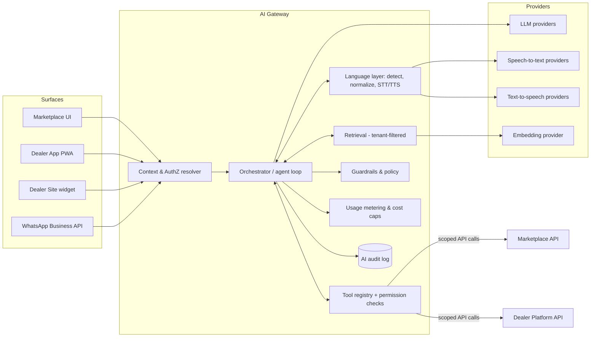
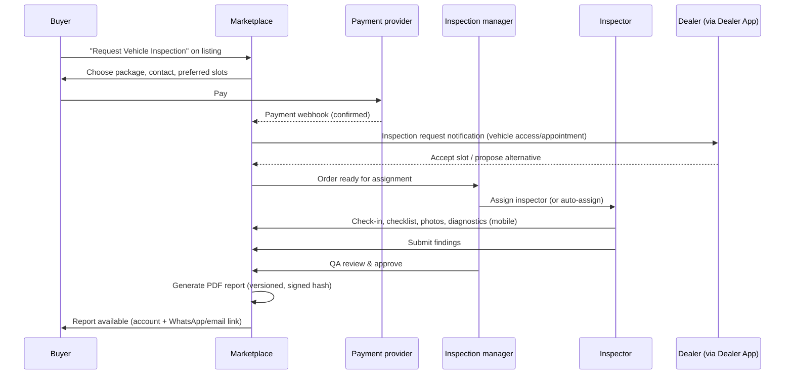
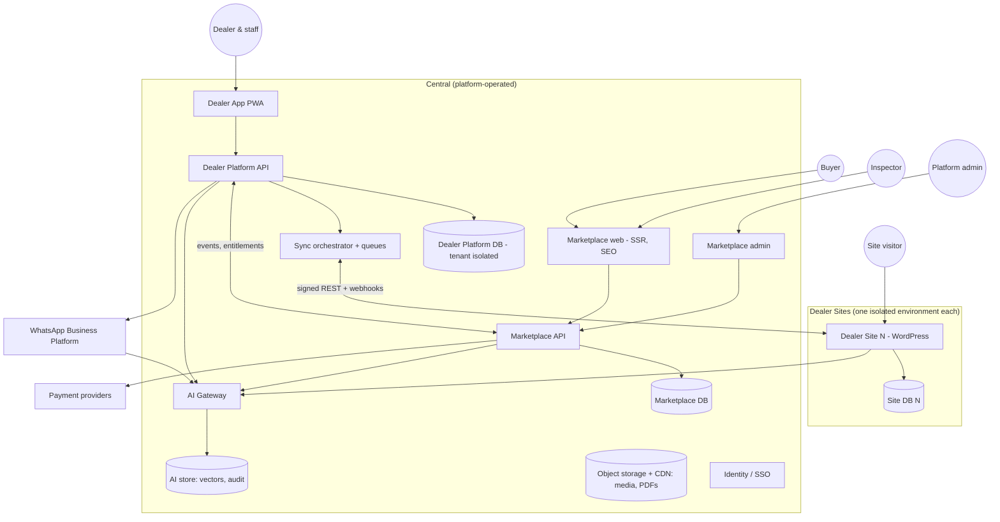
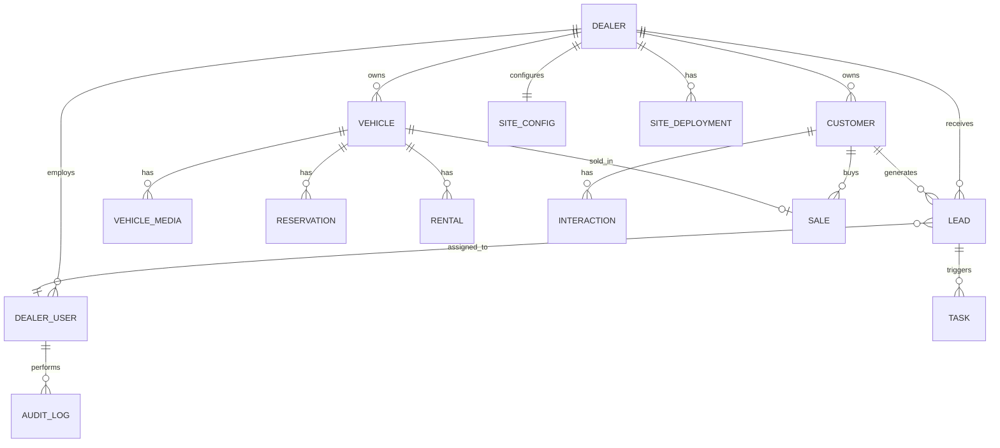
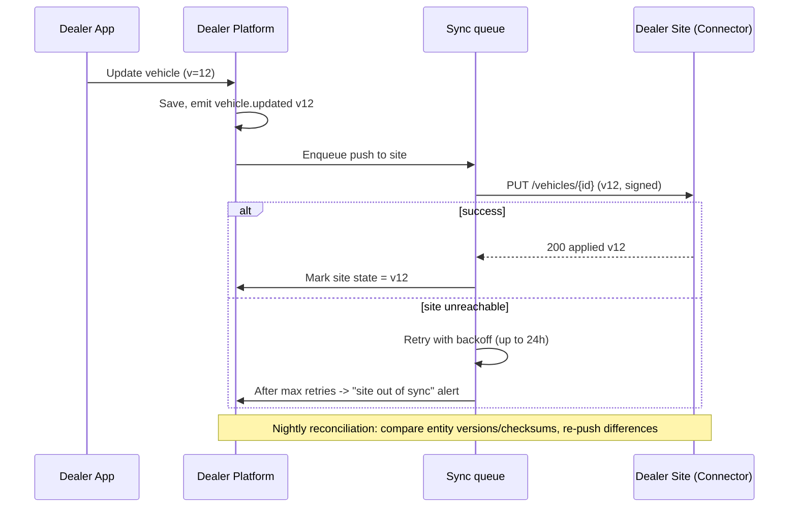
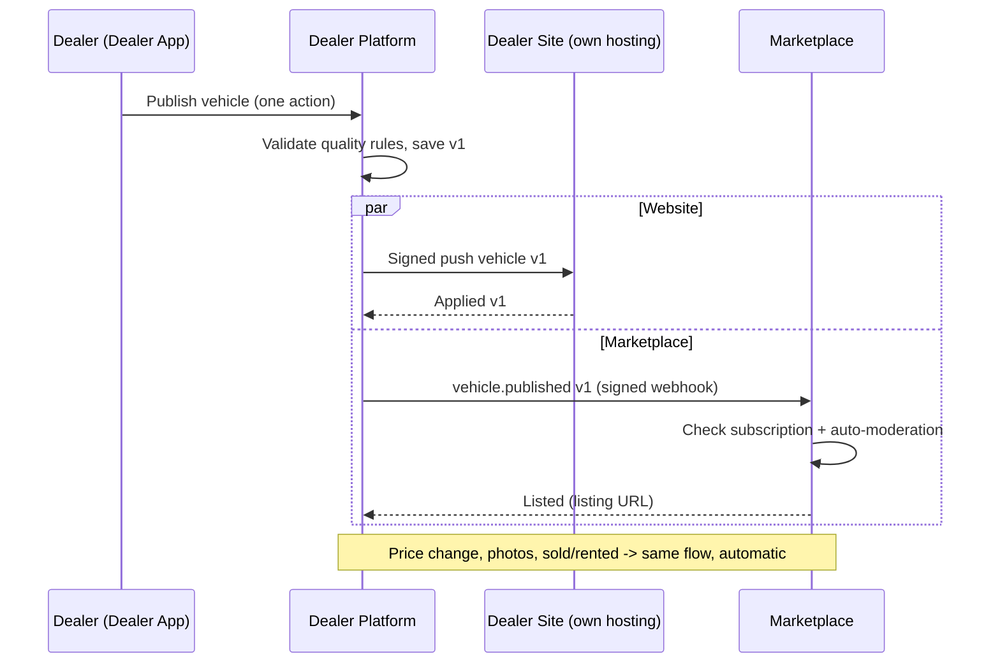
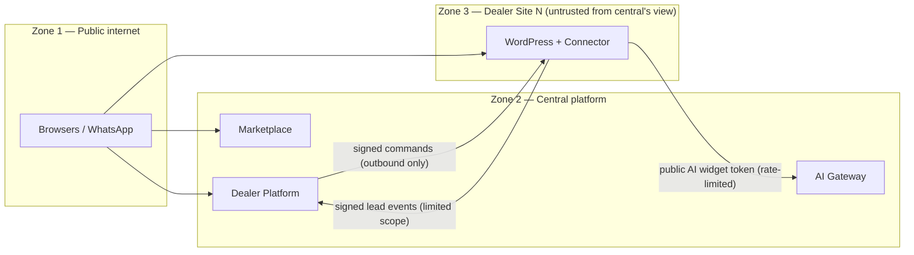
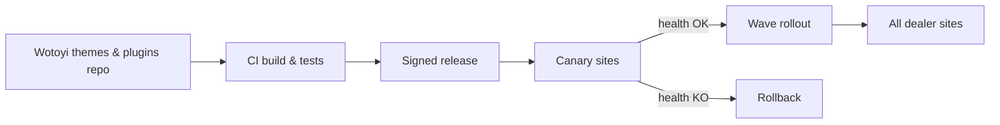

# PROJECT.md — Wotoyi · Automotive Digital Ecosystem

> **Status:** Architecture & specification baseline — v1.2 (2026-11-16)
> **Purpose:** Master product and technical reference. Any developer or AI coding agent must read this file before writing code.
> **Rule:** No implementation starts before the decisions marked **[OPEN – BLOCKING]** in §23 are resolved.

### Changelog

| Version | Changes |
|---|---|
| v0.1 | Initial baseline. |
| v0.2 | Owner directions: **own WordPress themes, builder and plugins for every platform** (Flatsome and UX Builder removed); WordPress for all three platforms; ultra-premium design and motion system with a measurable quality bar; SEO / GEO / SEA strategy; simplest and cheapest hosting plan; no-code administration model; **Wolof included everywhere (UI, content, AI text and voice)**; **Wolof voice ships in Beta even if imperfect**; **light and dark modes on all platforms**. New §25–§27; §1, §2, §6, §7, §11, §12, §16–§24 updated. |
| v0.3 | Owner directions: dealer sites hosted **separately and independently**, connected in a **simple** way (pairing code); **every dealer listing appears automatically on the Marketplace**; builder decision taken (**Gutenberg-based Wotoyi Builder**, goal: far better than UX Builder); **full pages, no empty sections**; visual direction "Teranga" proposed with a validated light/dark palette and fonts. §2, §5.3, §6.5, §7.1, §7.5, §13.6, §16.11–16.12, §23, §24, §25.3 updated. |
| v0.4 | Owner decisions: **development by the owner + AI coding agents** (with occasional senior review); **new brand name** (shortlist proposed); **default hosting = platform servers, dealer's own hosting allowed via pairing**; **"Teranga" visual direction confirmed**. Dealer App PWA framework set to React. New §28 Strategic Proposals. §16.12, §17, §21, §23 updated. |
| v0.5 | **Brand chosen: Wotoyi** (Wolof "woto yi" = "the cars"). Placeholder "ECO" names replaced by Wotoyi names everywhere. Regional expansion targets added (Mali, Burkina Faso, Guinea, Côte d'Ivoire). Competitive landscape added (§3.1). Language rule: "auto/voiture", never "car", in French copy. |
| v0.6 | **D-40 closed: one website, wotoyi.com**, with country + language folders; country domains only redirect. §26.5 updated. |
| v0.7 | Development-phase hosting: owner wants zero cost until everything is tested; domain bought after tests. Free shared hosting with a browser-only security wall (e.g. InfinityFree) is rejected for ecosystem testing; free local development proposed (§18.1). |
| v0.8 | Owner's build plan: **Marketplace first**, delivered as installable WordPress theme + plugins (zips), fully tested, with original images and logo, plus simple PPTX installation guides; other platforms afterwards. New §29 Build Plan. |
| v0.9 | Owner directive: **every recommendation in this document is applied directly in each delivery — nothing postponed to "later" when it can be built now**; speed with excellence. Marketplace v1 scope expanded to the full scope (§29). |
| v1.0 | **Arabic added as 4th language everywhere, including AI** (right-to-left layouts from day one, §9.5). Development team organisation and brief added (§30, DEV_BRIEF.md). |
| v1.1 | **Marketplace v1.0 delivered** (W1–W14, see DELIVERY-NOTES.md). Company operating system adopted: Claude = co-founder & CEO, 6 departments / 22 agents, **model routing: think with Fable, execute with Sonnet/Haiku** (§31, CLAUDE.md). |
| v1.2 | Founder not satisfied with v1 design → **Wotoyi v2 programme** (§32): "Luxe Motion" redesign with advanced animations, maximum search filters and vehicle details, AI on every platform, Dealer Platform + Wotoyi Pro + dealer themes + Connector built now, dealer "Gestion" page on the dealer site, automatic sync of vehicles **and services** to the Marketplace, language switcher on the Marketplace only, InfinityFree single-install demo mode, independent Coach agent. |

### Legend (used throughout)

| Tag | Meaning |
|---|---|
| **[CONFIRMED]** | Decided by the project owner. Do not change without explicit approval. |
| **[PROPOSED]** | Architect's recommendation. Default for implementation unless the owner rejects it. |
| **[ASSUMPTION]** | Working hypothesis, must be validated. |
| **[OPEN]** | Unresolved decision. Listed in §23 with an ID (D-xx). |

### Sources used for this document

- The project owner's master brief (2026-11-16).
- Previously stated project context (v0.1): WordPress + Flatsome + proprietary plugin (Flatsome replaced in v0.2), one independent site/DB/CRM per dealer, dealer never uses wp-admin, central marketplace in Dakar (FR/Wolof/EN) that is also the acquisition channel for the SaaS, WhatsApp AI assistants (Wolof, voice notes), paid pre-purchase inspection sold through the marketplace.
- Earlier brand names **CTU Prime** and **Carbuzy** are abandoned. **The brand is Wotoyi** (v0.5, §28.1).
- No `CLAUDE.md`, existing codebase or prior technical documentation was available when this version was written. **When the existing "dealer-area / manager-area" code is shared, §6 and §12 must be reconciled with it.**

### Product names

| Name | Meaning |
|---|---|
| **Wotoyi** (the Marketplace) | Platform One — public marketplace + central administration + billing + inspections |
| **Wotoyi Pro** (the Dealer App) | Platform Two — dealer management application (PWA + its backend, "Dealer Platform") |
| **Dealer Site** | Platform Three — one independent WordPress website per dealer, in the dealer's own brand, with a discreet "Powered by Wotoyi" credit **[PROPOSED]** |
| **Connector** | Custom WordPress plugin installed on every Dealer Site |
| **AI Gateway** | Shared AI service used by all three platforms |
| **Wotoyi Suite** | The project's proprietary WordPress product suite — themes, builder, plugins (§25). Code prefix: `wotoyi-` / `wotoyi_` |
| **Wotoyi Builder** | Proprietary visual builder: *Pro mode* for the platform team, *Dealer mode* inside the Dealer App |

---

## 1. Executive Summary

The project is an automotive digital ecosystem for Senegal (Dakar first, then international) made of **three independent but connected platforms**:

1. **Marketplace** — a public, mobile-first, trilingual (French / Wolof / English) vehicle marketplace where buyers find vehicles and dealers, and can order a **paid professional pre-purchase inspection**. It also hosts central administration, dealer onboarding, subscriptions and payments.
2. **Dealer App** — a premium PWA (desktop + mobile) that is the dealer's single working tool: CRM, leads, vehicles, sales, rentals, reservations, staff, reports, and **full control of the dealer's own website without ever touching WordPress admin**.
3. **Dealer Sites** — every subscribing dealer gets an independent WordPress website (own domain or subdomain, own install, own database, own branding), built on the project's own proprietary WordPress theme, builder and plugins, controlled remotely by the Dealer App through a secure Connector plugin, and able to keep running when central systems are down.

**AI is transversal**: one shared AI Gateway serves buyers (search, recommendations, Q&A), dealers (lead summaries, listing generation, analytics, authorized CRM actions) and website visitors (vehicle Q&A, lead capture, appointments, WhatsApp) — with strict per-dealer data isolation, permissions and audit logs. **Wolof (written, spoken, code-switched with French)** is a strategic differentiator and is designed in from day one, with provider selection based on real-world testing.

**Key architectural choice [PROPOSED]:** three platforms, **three separate data domains**, no shared database, no WordPress Multisite. The CRM lives **once**, in the Dealer Platform backend, with strict per-dealer isolation; Dealer Sites hold only what they need to render and to survive outages. Communication is via versioned, signed APIs and webhooks with an explicit data-ownership matrix.

**Product & design direction [CONFIRMED v0.2]:** all three platforms run on WordPress (separate installations, never Multisite) using the project's **own proprietary themes, visual builder and plugins** — no Flatsome, UX Builder or third-party page builder. Every platform must deliver an ultra-premium, innovative, highly responsive experience with high-quality animations on phone, tablet and desktop; best-in-class SEO, GEO (visibility in AI search engines) and SEA; light and dark modes with perfect contrast on every platform; **Wolof included** in every platform (interface, content, AI text and voice); the simplest and cheapest hosting; and no-code control of every design, content and configuration detail (§16, §18.4, §25–§27).

---

## 2. Product Vision

**Vision:** become the reference digital infrastructure for car dealers and car buyers in Senegal, then in other francophone African markets — combining a trusted marketplace, a professional SaaS for dealers, and AI that speaks the customer's language, including Wolof.

**Value proposition**

| For | Value |
|---|---|
| Buyers | Find vehicles fast in their language; contact dealers on WhatsApp; reduce risk with an independent paid inspection before buying. |
| Dealers | A professional website without technical skills, a CRM built for how they actually sell (WhatsApp, walk-ins, rentals), visibility on the marketplace, and an AI assistant that answers customers 24/7 in Wolof/French. |
| The business | Recurring SaaS revenue + transactional revenue (inspections, featured listings, setup fees) + a marketplace that feeds SaaS acquisition. |

**Product principles [CONFIRMED by brief]**

- Three independent platforms, one integrated ecosystem — not three disconnected products.
- The dealer never needs WordPress admin.
- Mobile-first everywhere; most users are on smartphones and variable connectivity.
- Wolof is a first-class language, not a translation afterthought.
- Never overclaim: inspections reduce risk, they do not certify mileage or accident history with absolute certainty.
- Controlled development and running costs; no unnecessary complexity.
- **[CONFIRMED v0.2]** Own WordPress themes, builder and plugins for every platform; no third-party premium theme or page builder.
- **[CONFIRMED v0.2]** Ultra-premium, innovative, realistic design with high-quality animations on phone, tablet and desktop — measured by the quality bar in §16.1.
- **[CONFIRMED v0.2]** Best-in-class SEO, GEO and SEA (§26).
- **[CONFIRMED v0.2]** Simplest and cheapest hosting that still meets security and isolation requirements (§18.4).
- **[CONFIRMED v0.2]** Every design, content, text, price and setting editable without code (§27).
- **[CONFIRMED v1.0]** **Four languages: French, Wolof, English and Arabic** on all platforms and in the AI (§9.5).
- **[CONFIRMED v0.2]** **Wolof is included** — not "planned": Wolof interface, content and AI (text and voice) on all three platforms; Wolof voice launches even if not yet perfect (§9.4).
- **[CONFIRMED v0.2]** Light and dark modes on all platforms, everything readable and visible in both (§16.9).
- **[CONFIRMED v0.3]** Dealer websites are hosted separately and independently, and connected to the ecosystem in the simplest possible way (§7.1, §13.6).
- **[CONFIRMED v0.3]** Every vehicle a dealer publishes appears automatically on the Marketplace — no double entry (§5.3).
- **[CONFIRMED v0.3]** Full, rich pages everywhere — no empty or unfinished-looking sections (§16.11).

---

## 3. Business Objectives

| # | Objective | Measure (targets **[OPEN]**, to be set by the owner) |
|---|---|---|
| BO-1 | Acquire paying dealers in Dakar | Number of active subscriptions, churn |
| BO-2 | Build marketplace inventory and traffic | Active listings, monthly visitors, leads sent to dealers |
| BO-3 | Monetize trust through inspections | Inspection orders, conversion from listing views, NPS |
| BO-4 | Make the Dealer App indispensable | Weekly active dealers, leads processed in-app |
| BO-5 | Differentiate through Wolof AI | Share of conversations in Wolof, AI resolution rate, lead capture rate |
| BO-6 | Prepare regional expansion: **Mali, Burkina Faso, Guinea, Côte d'Ivoire** first (francophone West Africa), then further | Country/currency/language/payment configurable without code changes **[CONFIRMED v0.5 targets]** |
| BO-7 | Replace the owner's salaried income with recurring revenue | MRR (target **[OPEN]**) |

**[ASSUMPTION]** Initial go-to-market is direct sales to Dakar dealers, with the marketplace acting as a showcase and lead channel.

### 3.1 Competitive landscape (first scan, November 2026 — to deepen in Phase 0)

Online automotive players already active in Senegal, found by web search: **Gaaraas** (presents itself as the leading online automotive marketplace in Senegal), **Auto24** (buying and selling cars in Dakar and across Senegal), general classifieds **Coinafrique** and **Expat-Dakar**, **Senauto**, and **Dakar-Auto**. Positioning, pricing and features were not analysed yet **[OPEN]**.

Wotoyi's differentiation **[PROPOSED]**: (1) a complete SaaS for dealers (CRM + own website), not just listings; (2) paid independent inspection and trust signals; (3) Wolof AI (text and voice) and WhatsApp-native experience; (4) premium design; (5) regional ambition from day one.

---

## 4. Target Users

| Persona | Platform | Description | Key needs |
|---|---|---|---|
| **Buyer** | Marketplace, Dealer Sites | Individual looking for a car; mostly mobile, WhatsApp-native; French, Wolof or both | Search, trust, quick contact, inspection, saved vehicles |
| **Diaspora buyer** [ASSUMPTION] | Marketplace | Senegalese abroad buying for family | Remote inspection, reports, trust, payment from abroad |
| **Dealer owner** | Dealer App | Runs a dealership or rental agency; non-technical; works from phone | Leads, stock, sales, website control, reports |
| **Dealer employee** | Dealer App | Salesperson, rental agent, receptionist | Assigned leads, tasks, vehicle updates, limited permissions |
| **Inspector** | Marketplace (inspector interface) | Mechanic/inspector, possibly a partner company | Assigned jobs, checklists, photo upload on mobile, offline tolerance |
| **Platform admin** | Marketplace admin | Owner's team | Dealers, billing, moderation, inspections, support, settings |
| **Support agent** | Marketplace admin | Handles buyers and dealers | Tickets, conversation history, refunds (with permission) |
| **Website visitor** | Dealer Site | Customer of a given dealer | Browse stock, ask questions, book visit/test drive, WhatsApp |

---

## 5. Platform One: Marketplace

### 5.1 Scope

**Public (buyers)**

| Feature | Notes |
|---|---|
| Vehicle listings & detail pages | Photos, video, specs, price (or "price on request" — **[OPEN] D-14**), dealer card, location, WhatsApp button, "Request inspection" CTA |
| Search & advanced filters | Make, model, year, price, mileage, fuel, transmission, body type, condition (new / used / imported "venant de" **[ASSUMPTION]**), location, sale/rent, dealer |
| Categories | Configurable taxonomy (body types, sale vs rental, budget ranges, etc.) |
| Dealer profiles | Public profile with all dealer listings, contact, link to the Dealer Site |
| Featured listings | Paid boost, clearly labelled "Sponsored/Featured" |
| Contact dealer | Form + WhatsApp deep link (`wa.me`) + call; every contact creates a **lead** sent to the Dealer App |
| User accounts | Email/phone + OTP **[PROPOSED]**; social login optional later |
| Favorites / saved vehicles / saved searches | Saved searches with alerts in a later phase |
| Inspection ordering | See §10 |
| Multilingual UI | FR (default) / Wolof / EN, per-URL language for SEO (§9) |
| AI search assistant | Phase 3+ (§8) |

**Dealer-facing on the Marketplace**

- Dealer registration, KYC-light verification **[PROPOSED]** (business registration document/NINEA **[ASSUMPTION]**, ID of manager, address), plan selection, payment, onboarding checklist.
- After activation, the dealer works exclusively in the Dealer App; listings flow from the Dealer App to the Marketplace (dealers do not maintain listings twice).

**Independent sellers (private individuals)** — **[OPEN] D-13**: allowed or dealers only? Default for MVP **[PROPOSED]**: dealers only (quality and trust).

### 5.2 Central administration

Modules: Dealers · Users · Vehicles (moderation) · Subscriptions & plans · Payments & invoices · Inspection orders · Inspectors · Inspection reports · Commissions · Revenue dashboards · Customer support (tickets) · Platform settings (languages, countries, currencies, taxonomies, prices, packages, email/WhatsApp templates, legal texts) · Audit log viewer · Feature flags.

Admin roles **[PROPOSED]**: Super admin, Operations (dealers, listings), Inspection manager, Finance, Support (read-mostly), Content/SEO.

### 5.3 Business rules

- Marketplace has **its own database and business logic** **[CONFIRMED]**.
- **Automatic listing [CONFIRMED v0.3]:** every vehicle a dealer publishes appears **automatically** on the Marketplace — no second action, no double entry. Conditions checked automatically: active subscription, vehicle published/available, automatic quality rules passed (required fields, at least one photo, no forbidden content). Every update (price, photos, specs, reserved/sold/rented) propagates automatically; sold or rented vehicles leave the Marketplace automatically (policy D-35). Admin moderation can still hide a listing, with audit log.
- If a subscription lapses: listings are hidden (not deleted) after a grace period (**[OPEN] D-15** duration).
- Featured status, view counts, favorites and buyer accounts are **owned by the Marketplace** (§12).

---

## 6. Platform Two: Dealer Management Application

### 6.1 Core principle

The Dealer App is the dealer's only interface. It **controls** the dealer's CRM and the dealer's independent website. The dealer **never** receives WordPress admin credentials **[CONFIRMED]**.

It evolves the existing "dealer-area / manager-area" concept **[CONFIRMED]**. **[OPEN] D-02**: the existing code must be reviewed to decide reuse vs rewrite. Default **[PROPOSED]**: reuse the UX concepts and field definitions, re-implement as a standalone app (see §11 for why the CRM should not stay inside each WordPress).

### 6.2 Delivery

- Installable **PWA** (manifest, service worker, offline shell, add-to-home-screen, push notifications where supported) **[CONFIRMED]**.
- Desktop and mobile layouts from one codebase; mobile is the primary design target.
- Offline tolerance **[PROPOSED]**: read-only cache of recent leads/vehicles; queued actions (notes, status changes) synced when back online. Vehicle photo upload queued with progress and resume.

### 6.3 CRM modules

| Module | Key capabilities |
|---|---|
| **Customers** | Profile, phone/WhatsApp, language preference, tags, consent flags, linked vehicles, history |
| **Leads** | Unified inbox from Marketplace, Dealer Site, WhatsApp, phone, walk-in; source tracking; assignment; status; duplicate detection by phone |
| **Communication history** | Timeline: calls logged, WhatsApp messages (when API connected), notes, emails, AI conversation transcripts and summaries |
| **Sales pipeline** | Configurable stages (default **[PROPOSED]**: New → Contacted → Visit/Test drive → Negotiation → Reserved → Won / Lost), drag-and-drop on desktop, swipe/status on mobile |
| **Vehicles** | See §6.5 |
| **Rentals** | Rental fleet, calendar availability, contracts, start/end dates, daily/weekly price, deposit, mileage out/in, status |
| **Reservations** | Hold a vehicle for a customer (sale) or book a rental period; conflict detection |
| **Employees** | Invite staff, roles & permissions (Owner, Manager, Sales, Rental agent, Read-only **[PROPOSED]**), activity log |
| **Tasks & reminders** | Per user, linked to lead/customer/vehicle; due dates; push/WhatsApp reminder to the employee |
| **Follow-ups** | Automatic follow-up suggestions (e.g. no contact for X days), AI-assisted later |
| **Sales tracking** | Sale record: vehicle, customer, price, salesperson, date, payment status (informational, not accounting) |
| **Revenue tracking** | Sales + rentals revenue dashboards; **not an accounting system** **[PROPOSED]** |
| **Reports** | Stock age, leads by source, conversion, salesperson performance, rental occupancy |
| **Excel exports** | `.xlsx` export for customers, leads, vehicles, sales, rentals; full data export on request (data portability) |

### 6.4 Website management (remote control of the Dealer Site)

| Editable element | Mechanism **[PROPOSED]** |
|---|---|
| Logo, favicon | Upload → pushed to site media library via Connector |
| Brand & design | Colors, fonts (curated list), corner style, animation intensity — mapped to the design tokens (§16.2, §25) with guardrails that keep every site premium |
| Contact info, address, map, opening hours | Structured settings |
| WhatsApp number | Structured setting; used by floating button and site AI |
| Homepage & page layouts | **Wotoyi Builder — Dealer mode**: premium pre-designed sections (hero, featured vehicles, services, testimonials, team, CTA, FAQ, gallery, 360° showcase) that the dealer can add, reorder, restyle within guardrails, fill and preview per device (phone / tablet / desktop) |
| Pages content (About, Services, etc.) | Structured fields + limited rich text |
| Images | Media library managed through the App |
| Vehicle listings | Automatic from the CRM (dealer chooses which vehicles are published on the site) |
| Services | List of structured items |
| Team | Members with photo/role (optional phone) |
| SEO | Site title, meta description per page, social image, Google Business link, sitemap on/off; per-vehicle SEO auto-generated |
| Languages | Which of FR/Wolof/EN the site shows **[PROPOSED]** |
| Domain | Subdomain by default; custom domain via guided process (handled by platform team in MVP) |

Changes are applied through a **draft → preview → publish** flow **[PROPOSED]**, so a dealer cannot break the live site by accident. A "Restore previous version" action keeps the last N published configurations.

**Dealer mode of the builder [CONFIRMED v0.2 direction, PROPOSED mechanics]:** the dealer edits pages visually in the Dealer App with the same blocks and render engine as the proprietary builder (§25). Layouts are stored as structured block data, so the Dealer App can edit them safely through the API. Guardrails (locked structure where needed, curated fonts and colors, spacing presets) guarantee that every dealer site stays premium.

### 6.5 Vehicle management

- Create/edit with a mobile-first wizard (photos first, then key specs, then details).
- Multiple images (reorder, set cover, auto-compress client-side, watermark option **[PROPOSED]**) and videos (upload size limits or YouTube/TikTok link **[OPEN] D-16**).
- Technical specs: make, model, version, year, mileage, fuel, transmission, engine, power, color, doors, seats, body, VIN/chassis number (private by default), options/equipment list, condition, origin.
- Pricing: sale price, negotiable flag, rental prices, currency (XOF default, multi-currency ready).
- Availability states: `draft`, `available`, `reserved`, `sold`, `rented`, `in_maintenance`, `archived`.
- Rental fields: rental eligibility, daily/weekly/monthly rates, deposit, rental calendar, current renter, start/end dates.
- Publication: one **Publish** action puts the vehicle on the Dealer Site **and** automatically on the Marketplace **[CONFIRMED v0.3]**. A per-vehicle "hide from Marketplace" option is **[OPEN] D-38**.
- Customer linkage: buyer/renter linked to customer record.

### 6.6 UX requirements specific to the Dealer App

Professional, premium, fast, mobile-first, fully responsive, easy for non-technical dealers **[CONFIRMED]**. Avoid oversized logos, wasted spacing, complicated navigation and desktop layouts on mobile **[CONFIRMED]**. Details in §16.

---

## 7. Platform Three: Independent Dealer Websites

### 7.1 Isolation requirements [CONFIRMED]

Each dealer has: own domain or subdomain · own hosting environment · own WordPress installation · own database · own design and branding · own CRM data · website administration exclusively through the Dealer App. **No WordPress Multisite.**

**Hosting [CONFIRMED v0.3]:** each dealer website is hosted **separately and independently** — its own hosting environment, its own database, its own files, its own credentials and its own backups. No dealer site depends on another dealer site.

**Hosting-agnostic [PROPOSED]:** the only link between a dealer site and the ecosystem is the Connector plugin. A dealer site can therefore run on platform-operated servers (default, cheapest to automate) **or** on any standard WordPress hosting, including a hosting account owned by the dealer. Which option is offered by default and in which plan remains a cost decision → **D-04**.

**Simple connection [CONFIRMED v0.3 principle]:** connecting a site = Connector installed + one-time pairing code from the Dealer App; keys, health check and first full sync are automatic (§13.6).

**Interpretation [PROPOSED] of "own CRM data":** each dealer's CRM data is logically and securely isolated, exportable at any time, and never accessible to other dealers — but stored in the Dealer Platform (tenant-isolated), not inside each WordPress database. This satisfies "do not duplicate CRM logic across installations" (§10 of brief). → **[OPEN – BLOCKING] D-03** (see §11.3 for the trade-off).

### 7.2 Standard site build ("golden image")

| Component | Choice |
|---|---|
| Core | WordPress (latest stable), PHP 8.2+ **[PROPOSED]** |
| Theme | Proprietary block theme framework + dealer template packs (§25) **[CONFIRMED v0.2]** |
| Builder & layouts | Wotoyi Builder sections and templates; dealers edit only through the Dealer App (Dealer mode) **[CONFIRMED v0.2]** |
| Connector plugin | Custom, mandatory, auto-updated from a private update server |
| Vehicles | Custom post type `vehicle` + taxonomies, managed only by the Connector (not WooCommerce products) **[PROPOSED]** |
| WooCommerce | Not installed by default. Only if a dealer needs online payments (e.g. reservation deposits) — **[OPEN] D-17** |
| Multilingual | Proprietary `wotoyi-i18n` plugin (FR/Wolof/EN), no third-party translation plugin **[CONFIRMED v0.2]** — see §9 |
| SEO | Proprietary `wotoyi-seo` plugin (§26) **[CONFIRMED v0.2]** |
| Cache/perf | Page cache + image optimization (WebP) + CDN **[PROPOSED]** |
| Security | Hardened config, wp-admin restricted to platform staff, XML-RPC disabled, file editing disabled, automatic security updates |

**Licensing:** no third-party premium theme or builder, so no per-site license cost (former D-06 closed). Only proprietary or free/open-source, security-reviewed components are allowed in the golden image.

### 7.3 Connector plugin responsibilities

1. Expose a **private, authenticated REST namespace** (`/wp-json/wotoyi-connector/v1/...`) accepting signed commands from the Dealer Platform only: apply settings, upsert/delete vehicles, manage media, publish section configuration, health check, cache purge.
2. Store a **local copy** of everything the site must display (settings, vehicles, media) so the site works when central systems are down.
3. Capture **leads** (forms, appointment requests, AI chat) into a local **outbox table**, then deliver them to the Dealer Platform with retries (§13.7).
4. Render the vehicle catalog, filters, vehicle pages, WhatsApp button, contact/appointment forms, and embed the website AI widget.
5. Report health and version (heartbeat) to the Dealer Platform.
6. Enforce security: no public write endpoints except rate-limited lead capture with anti-spam.

### 7.4 Independence and degradation

| Central component down | Dealer Site behaviour |
|---|---|
| Marketplace down | No impact. |
| Dealer Platform down | Site fully renders from local data; leads queued locally and also emailed/WhatsApp-notified to the dealer as fallback **[PROPOSED]**; dealer cannot edit the site until recovery. |
| AI Gateway down | AI widget hides itself or shows "Contact us on WhatsApp"; forms still work. |
| Dealer Site down | Marketplace and Dealer App unaffected; health monitor alerts the platform team. |

### 7.5 Provisioning (automated) [PROPOSED]

Dealer activated → provisioning job: create isolated environment → create DB + user → install golden image via WP-CLI → install Connector with per-site credentials → configure subdomain + TLS → apply default template in dealer's language → initial sync of vehicles/settings → health check → notify dealer. Target: fully automated, no manual WordPress work.

**Sites hosted elsewhere [PROPOSED]:** install the golden image (theme + Connector) on the chosen hosting → enter the pairing code → automatic key exchange, health check and initial sync. Installation on external hosting is done by platform staff or the dealer's webmaster; the dealer still never needs wp-admin afterwards.

---

## 8. AI Architecture

### 8.1 Principles

- **One shared AI Gateway**, used by all three platforms; no per-site AI implementations **[CONFIRMED: transversal AI]**.
- **Provider-agnostic**: models accessed through an adapter layer; the provider can change per capability (chat, STT, TTS, embeddings) and per language.
- **Tenant-scoped**: every AI request carries a verified context: `{surface, dealer_id?, user_id?, roles, language}`. The gateway only retrieves data and calls tools allowed in that context.
- **Tools, not raw DB access**: the AI acts only through explicitly defined tools (functions) that enforce the same authorization as the regular API.
- **Human-in-the-loop** for consequential actions (e.g. sending a message on the dealer's behalf, changing a price, deleting data) — confirmation required **[PROPOSED]**.
- **Everything audited**: prompts, tool calls, results, user confirmations, cost.

### 8.2 Component diagram

### 8.3 Assistants and their allowed tools

| Assistant | Context | Data it may read | Actions (tools) |
|---|---|---|---|
| **Marketplace buyer assistant** | Anonymous or buyer account | Public listings, public dealer profiles, inspection packages, FAQ | `search_vehicles` (NL → filters), `get_vehicle`, `compare_vehicles`, `explain_inspection`, `create_lead` (with consent), `start_inspection_order` (redirect to checkout) |
| **Dealer App assistant** | Authenticated dealer user | That dealer's CRM only, filtered by the user's role | `search_crm`, `summarize_conversation`, `draft_vehicle_description`, `draft_reply`, `create_task`, `update_lead_status`*, `generate_report`, `analyze_sales`. *Write actions require confirmation and permission. |
| **Dealer Site assistant** | Anonymous visitor of dealer X | Dealer X's published vehicles, site info, FAQ | `search_dealer_vehicles`, `get_vehicle`, `capture_lead`, `request_appointment`, `handoff_to_whatsapp` |
| **WhatsApp assistant (per dealer)** | Customer on dealer X's WhatsApp number | Same as Dealer Site assistant + that customer's own history with dealer X | Same as Dealer Site + `handoff_to_human` |

**Isolation rule [CONFIRMED]:** an assistant belonging to dealer A can never read or act on dealer B's private data. Enforced by: (1) dealer_id derived from authenticated credentials, never from user/model input; (2) retrieval filtered by tenant at query level; (3) tools calling the Dealer Platform API with a token scoped to that dealer; (4) automated isolation tests (§24).

### 8.4 Retrieval (RAG) [PROPOSED]

- Public knowledge: listings, dealer profiles, inspection docs, FAQ (per language).
- Private knowledge: per-dealer CRM notes and conversation summaries, stored with `dealer_id` and access level; embeddings in the database's native vector support (MariaDB 11.7+ vector type — to verify in Phase 5) or a lightweight self-hosted vector store; no costly managed vector DB initially.
- Structured queries (stock, prices, counts) go through tools/SQL via the API, not through embeddings — avoids hallucinated numbers.

### 8.5 Safety & guardrails

- The AI never invents vehicle facts, prices or availability: answers come from tool results; if unknown, it says so and offers to connect to the dealer.
- Inspection language rules (§10.6) apply to the AI.
- Prompt-injection defence: content from listings/visitors is treated as data; tools re-check permissions server-side.
- PII minimization in prompts; no training on customer data without explicit agreement with the provider (**[OPEN] D-10** provider data terms).
- Cost control: per-dealer monthly AI quotas tied to plan; rate limits; model tiering (small model for classification/routing, larger only when needed).

### 8.6 Roadmap of AI capabilities

| Phase | Capability |
|---|---|
| Phase 2 | Vehicle description generation (FR/EN/Wolof drafts), lead summaries in the Dealer App |
| Phase 3 | Marketplace NL search & Q&A; Dealer Site text assistant |
| Phase 4 | WhatsApp text assistant per dealer (after WhatsApp Business API integration) |
| Phase 5 | WhatsApp voice notes (STT → reply as text or TTS), Dealer App analytics assistant with authorized actions |
| Phase 6 | AI voice calls (inbound/outbound), Wolof included in Beta with human handoff |

---

## 9. Wolof and Multilingual Strategy

### 9.1 Languages [CONFIRMED]

French · Wolof · English. **Wolof is included on all three platforms from the MVP** (interface, content, AI text and voice) and is presented as such to users and dealers **[CONFIRMED v0.2]**. Default **[PROPOSED]**: French for UI fallback; user's choice persisted; AI replies in the language (or mix) the user writes in.

### 9.2 Architecture from day one

- All user-facing strings externalized (i18n keys) in every platform, including the Connector and child theme. No hard-coded text.
- Locale codes: `fr`, `wo`, `en` (ISO 639-1); `wo-SN` where region matters.
- **Wording rule [CONFIRMED v0.5]:** in French copy use **« auto » / « voiture »**, never « car » (in Senegal a « car » is a large passenger vehicle such as a car rapide). Expansion countries add their own locales (e.g. `fr-CI`, `fr-ML`) and, later, local languages.
- Translatable content model: listing descriptions, site content, inspection packages, email/WhatsApp templates stored per locale with fallback chain (`wo → fr`, `en → fr`) **[PROPOSED]**.
- SEO: language-specific URLs (`/fr/`, `/wo/`, `/en/`) + `hreflang`. **[ASSUMPTION]** Search volume in written Wolof is low; Wolof pages target engagement and brand differentiation, French remains the main SEO language.
- Numbers, currency (XOF, no decimals), dates and phone formats (+221) localized.

### 9.2b Arabic [CONFIRMED v1.0]

Arabic is the 4th language on all three platforms and in every AI assistant (text; voice where providers support it). See §9.5 for right-to-left requirements.

### 9.3 Wolof-specific challenges

| Challenge | Approach |
|---|---|
| Orthography varies (official Latin orthography vs. informal/French-influenced spelling in WhatsApp) | AI must **understand** informal spelling; UI translations written in a consistent standard chosen with native reviewers (**[OPEN] D-08**) |
| Code-switching (Wolof–French in the same sentence) is normal | Never force a single language; language detection is per message, reply mirrors the user |
| Automotive vocabulary is often French loanwords | Maintain a domain glossary (FR ⇄ Wolof ⇄ EN) curated by native speakers |
| Speech: accents, noise, voice notes | STT evaluation on real voice notes (§9.4) |
| Provider quality is uneven | **Do not assume support**; evaluate before choosing **[CONFIRMED]** |

### 9.4 Provider evaluation protocol [PROPOSED]

1. Build a **test corpus** (with consent, anonymized): ≥ 200 written messages (pure Wolof, pure French, mixed, informal spelling) and ≥ 100 voice notes (different speakers, ages, noise levels), covering real car-buying intents (price, availability, negotiation, appointment, financing, inspection).
2. Candidates: several LLM providers for text; several STT and TTS providers including specialized/local African-language providers and open models (exact list to be researched at evaluation time — not assumed here).
3. Metrics: intent understanding accuracy, answer correctness, naturalness rated by ≥ 3 native speakers (1–5), code-switch handling, STT word error rate, TTS intelligibility/naturalness, latency, cost per conversation, data-privacy terms.
4. Decision gate: a provider is selected per capability only if it reaches the thresholds set by the owner (**[OPEN] D-09**). Re-run quarterly; the adapter layer allows switching.
5. **Wolof voice launches even if it is not perfect [CONFIRMED v0.2].** The evaluation selects the *best available* provider; it is not a launch gate. Safeguards:
   - visible **"Beta"** label on Wolof voice features;
   - the assistant **confirms key information** back to the user (vehicle, price, date, phone number) before acting;
   - one-tap switch to Wolof text, French or a human at any time; automatic handoff to a human when confidence is low;
   - transcripts corrected by staff (with consent) feed a Wolof glossary and future provider tuning;
   - D-09 thresholds measure progress over time; the Beta label is removed when they are reached.

---

### 9.5 Arabic and right-to-left (RTL) [CONFIRMED v1.0]

**Why it is worth it (project manager's assessment):** many vehicles sold in West Africa are imported through Arabic-speaking markets (e.g. Gulf exporters); Arabic is widely read in Senegal (Franco-Arabic education) and in neighbouring markets such as Mauritania; the owner works from Morocco. **Cost warning:** RTL is cheap if built from day one and expensive to retrofit — so it is built from day one.

- Locale `ar` (`ar-SN`, later `ar-MR`, etc.); `hreflang` and URL folders (`/ar-sn/`).
- `dir="rtl"` per language; all CSS written with **logical properties** (`margin-inline-start`, `inset-inline-end`, `text-align: start`); no left/right hard-coding; directional icons mirrored; numbers and prices kept readable (Western digits by default, configurable — D-41).
- Arabic web font under an open licence (e.g. a variable Arabic sans pairing with Sora/Manrope), self-hosted, with correct line-height for Arabic script.
- Builder, Dealer App, PDF reports, emails and WhatsApp templates all support RTL.
- AI: Arabic understanding and answers (Modern Standard Arabic; dialect handling evaluated), including mixed Arabic/French messages; same provider evaluation protocol as Wolof (§9.4).
- Every screen is tested in RTL in addition to light/dark × phone/tablet/desktop.

---

## 10. Vehicle Inspection Service

### 10.1 Business positioning

Paid, professional pre-purchase inspection ordered by buyers on the Marketplace **[CONFIRMED]**. Major revenue and trust driver.

### 10.2 Order flow

### 10.3 Order state machine

`draft → pending_payment → paid → awaiting_dealer_confirmation → scheduled → assigned → in_progress → submitted → under_review → completed`
Side states: `cancelled_by_buyer`, `refused_by_dealer`, `vehicle_unavailable`, `no_show`, `refund_pending`, `refunded`, `disputed`.

Refund/cancellation rules per state: **[OPEN] D-12** (business decision).

### 10.4 Configurable packages

Admin-defined packages, each composed of **service modules** with its own checklist template, price, duration and required inspector qualification:

| Module (candidate) | Notes |
|---|---|
| Exterior & interior inspection | Body, paint thickness (if tool available), glass, tyres, interior wear |
| Mechanical inspection | Engine, gearbox, suspension, brakes, leaks, fluids |
| Electronic diagnostic scan | OBD fault codes, readiness monitors |
| Mileage consistency check | Cross-check odometer vs wear, service records, ECU data where readable — **consistency indicators only** |
| Accident & damage assessment | Visual/structural signs of repair — **indicators only** |
| Document verification | Registration (carte grise), customs documents, ownership chain as presented — checks presented documents, does not guarantee legal status |
| Road test | Only when possible and authorized by the dealer/owner |
| Comprehensive | Bundle of all modules |

Prices, bundles, and inspector payouts are **configurable; no prices defined here** **[CONFIRMED]**.

### 10.5 Inspector interface [PROPOSED]

Mobile PWA screen inside the Marketplace (role `inspector`): job list, navigation link, checklist with pass/attention/fail + comment per item, photo capture (compressed, geotag + timestamp), diagnostic file/scan upload, offline capture with later sync, signature/check-in confirmation.

### 10.6 Report & legal language [CONFIRMED + PROPOSED]

- Professional branded PDF, report ID, date, inspector ID, vehicle identity (VIN as seen), photos, per-item results, overall summary, recommendations.
- **Mandatory disclaimer**: the report reflects the vehicle's condition observed on the inspection date with the methods listed; it **does not guarantee** mileage authenticity, absence of past accidents, or hidden defects. Wording reviewed by a lawyer (**[OPEN] D-11**).
- Forbidden wording anywhere (UI, AI, marketing): "certified mileage", "guaranteed accident-free", "100% verified".
- Reports are immutable once published; corrections create a new version. A hash of the PDF is stored to prove integrity.
- Report access: buyer who paid; dealer receives a copy only if the buyer agrees (**[OPEN] D-19**, default: buyer controls sharing).

### 10.7 Neutrality

Inspectors must be independent from the selling dealer. Conflict-of-interest rule: an inspector cannot inspect vehicles of a dealer they are affiliated with. Commission/partner fees with inspection partners are configurable **[CONFIRMED]**, and must not be tied to report outcome.

---

## 11. System Architecture

### 11.1 Context view

### 11.2 Components [PROPOSED]

| Component | Responsibility | Data store |
|---|---|---|
| **Marketplace** (web + API + admin) | Public catalog, buyers, dealer onboarding, plans, subscriptions, payments, featured listings, inspections, inspectors, reports, central admin, support | Marketplace DB |
| **Dealer Platform** (API + PWA) | CRM, vehicles (master), rentals, reservations, staff, tasks, reports, website configuration (desired state), sync orchestration to Dealer Sites, WhatsApp integration | Dealer Platform DB (tenant-isolated) |
| **Dealer Site** (WordPress + Connector) | Public website rendering, local catalog copy, lead capture outbox | One DB per site |
| **AI Gateway** | All AI capabilities, providers, RAG, audit, metering | AI tables (vectors, audit) in the central database |
| **Identity (SSO)** | Single sign-on for dealer users across Marketplace dealer area and Dealer App; service-to-service credentials | Part of Dealer Platform initially **[PROPOSED]** |
| **Object storage + CDN** | Vehicle media (originals + variants), PDFs | S3-compatible storage |
| **Queues & scheduler** | Sync jobs, webhooks, retries, emails, PDF generation, AI jobs | Action Scheduler + system cron (Redis object cache) |
| **Observability** | Logs, metrics, uptime, error tracking, alerts | Managed service or self-hosted |

**Pragmatic deployment [CONFIRMED v0.2 direction + PROPOSED details]:** every platform is a **separate WordPress installation** built with the Wotoyi Suite (§25):

1. **Marketplace install** — proprietary Marketplace theme + `wotoyi-marketplace`, `wotoyi-billing`, `wotoyi-inspection`, `wotoyi-seo`, `wotoyi-i18n`.
2. **Dealer Platform install** — headless WordPress backend (custom tables, REST API) running `wotoyi-crm`, `wotoyi-site-control` and the AI Gateway (`wotoyi-ai`, with its own tables and API boundary, extractable to a separate service later); it also serves the Dealer App PWA.
3. **One install per Dealer Site** — dealer template pack + `wotoyi-connector`.

One technology everywhere keeps hosting cheap and maintenance simple. Because the Dealer App and Connectors depend only on the versioned REST contract, the Dealer Platform backend can be replaced later without rebuilding the other platforms.

### 11.3 Key decision: where does the CRM live? (D-03)

| Option | Description | Pros | Cons |
|---|---|---|---|
| **A — Central tenant-isolated CRM [PROPOSED]** | CRM in the Dealer Platform DB, isolated per dealer (tenant-scoped data layer), Dealer Sites hold only website data | Single CRM codebase; fast cross-device app; AI can work safely on one API; easy updates; analytics; WhatsApp integration centralised | CRM data not physically inside the dealer's WordPress DB; requires strong tenant isolation |
| B — CRM inside each WordPress | Each Connector stores CRM in the site DB; Dealer App talks to each site | Physical data separation | CRM logic duplicated/upgraded on N sites; slow, fragile PWA (depends on each site's uptime); much harder AI, search, reporting, WhatsApp; higher security surface |
| C — Hybrid | Central CRM + periodic encrypted export of each dealer's CRM to their site/backup | Gives dealers a physical copy | Extra complexity; limited value |

Recommendation: **Option A**, implemented in the Dealer Platform install with **custom database tables (not posts/postmeta)**, a mandatory tenant-scoped data-access layer (no query can run without `dealer_id`), automated cross-tenant tests, per-dealer encrypted backups and self-service full export. Database-per-tenant stays possible later for large dealers. This honours "own CRM data" as ownership + isolation + portability, and honours "do not duplicate CRM logic".

### 11.4 Dealer identity

Every dealer has a global immutable `dealer_uuid` created at onboarding (Marketplace) and propagated to Dealer Platform, Dealer Site (Connector config) and AI Gateway. All cross-platform calls carry `dealer_uuid` **inside the authenticated credential**, never as a free parameter.

---

## 12. Data Architecture

### 12.1 Data ownership matrix [PROPOSED]

"Owner" = system of record; others hold read copies.

| Data | Owner | Copies / consumers | Direction |
|---|---|---|---|
| Dealer account, plan, subscription status, invoices | Marketplace | Dealer Platform (entitlements), Dealer Site (active flag) | MP → DP → DS |
| Dealer business profile (name, logo, contact, address) | Dealer Platform | Marketplace dealer profile, Dealer Site | DP → MP, DP → DS |
| Dealer users & roles | Dealer Platform | — | — |
| Vehicles (all fields, media) | Dealer Platform | Dealer Site (published subset), Marketplace (listing copy) | DP → DS, DP → MP |
| Marketplace listing metadata (featured, moderation status, views, favorites) | Marketplace | Dealer Platform (stats read) | MP → DP (stats) |
| Leads & customers & conversations | Dealer Platform | — | MP → DP, DS → DP (lead creation events) |
| Buyer accounts, favorites, saved searches | Marketplace | — | — |
| Website configuration (theme settings, sections, pages, SEO) | Dealer Platform (desired state) | Dealer Site (applied state) | DP → DS |
| Inspection packages, orders, inspectors, reports | Marketplace | Dealer Platform (notifications, appointment confirmation) | MP ↔ DP (events) |
| Payments | Marketplace (with payment provider as external truth) | — | — |
| AI conversations, embeddings, AI audit | AI Gateway (tagged by tenant) | Dealer Platform (transcripts/summaries for that dealer) | — |
| Media files | Object storage, referenced by owner record | Dealer Site may keep a local copy for independence | DP → storage → DS |

**Conflict rule:** only the owner writes. A non-owner that needs a change sends a command/event to the owner (e.g. Dealer Site cannot edit a vehicle; it can only create a lead).

### 12.2 Core entities (logical model, Dealer Platform)

Every tenant-owned table is a custom table with `dealer_id` (NOT NULL, indexed), accessible only through the tenant-scoped repository layer **[PROPOSED]**. Common columns: `id (UUID v7)`, `created_at`, `updated_at`, `version` (optimistic locking / sync), `deleted_at` (soft delete).

### 12.3 Marketplace entities (summary)

Dealer (mirror + billing), Plan, Subscription, Invoice, Payment, Listing (copy of vehicle + marketplace fields), Buyer, Favorite, SavedSearch, InspectionPackage, InspectionModule, InspectionOrder, Inspector, InspectionReport (versions), Commission, Ticket, Setting, AuditLog.

### 12.4 Dealer Site data

WordPress options (settings applied from DP), `vehicle` CPT + meta (mirror), media, `wotoyi_outbox` table (pending leads/events), `wotoyi_sync_state` table (last applied version per entity), `wotoyi_log` (local sync log).

### 12.5 Data protection

- Senegal personal data law (Law n° 2008-12 and the CDP authority) applies **[ASSUMPTION — verify with legal counsel]**; future countries add their own rules (§23 D-20).
- Consent recorded for marketing messages and WhatsApp contact.
- Retention policy per data type **[OPEN] D-21**.
- Right to export and delete per dealer and per buyer.

---

## 13. API and Integration Strategy

### 13.1 Style

- REST + JSON, OpenAPI 3.1 specs written **before** implementation **[PROPOSED]**.
- Versioning in path: `/api/v1/...`; breaking changes → `v2`, old version supported ≥ 6 months **[PROPOSED]**. Connector declares its supported API versions in heartbeat.
- Idempotency: all write commands accept `Idempotency-Key`; sync payloads carry `entity_id + version`.
- Standard error envelope: `{ "error": { "code", "message", "details", "request_id" } }`.
- Pagination: cursor-based.
- Time: UTC ISO-8601 everywhere; display in local time zone.

### 13.2 Integration flows

| Flow | Mechanism |
|---|---|
| Dealer Platform → Dealer Site (settings, vehicles, sections, media) | Signed REST **push** commands from the Sync orchestrator, queued with retries; Connector applies and acknowledges with applied version |
| Dealer Site → Dealer Platform (leads, appointment requests, health) | Connector outbox → signed POST to DP; retries with exponential backoff; heartbeat every N minutes |
| Dealer Platform → Marketplace (vehicle publication, dealer profile) | Events (`vehicle.published`, `vehicle.updated`, `vehicle.unpublished`, `dealer.profile.updated`) via signed webhooks |
| Marketplace → Dealer Platform (leads, subscription changes, inspection requests) | Events (`lead.created`, `subscription.changed`, `inspection.requested`, …) via signed webhooks |
| Payments → Marketplace | Provider webhooks, verified by provider signature, reconciled daily |
| WhatsApp → Dealer Platform / AI Gateway | WhatsApp Business Platform webhooks (per dealer number) |

### 13.3 Synchronization model

Rules: last-writer is always the owner (no merge conflicts); Connector rejects versions older than the stored one; full re-sync available ("Rebuild site from source").

### 13.4 Webhooks

- Payload: `{event_id, event_type, occurred_at, dealer_uuid, api_version, data}`.
- Signature header: HMAC-SHA256 over timestamp + body with a per-subscriber secret; reject if timestamp skew > 5 min (replay protection).
- At-least-once delivery; consumers deduplicate by `event_id`.
- Retries: exponential backoff, then dead-letter queue with admin replay.

### 13.5 Error handling & logging

- Correlation ID (`X-Request-Id`) propagated across all platforms and into AI calls.
- Structured JSON logs; no secrets or full PII in logs.
- Alerts: sync backlog, failed webhooks, site down, payment webhook failures, AI error rate, cost spikes.

### 13.6 Simple connection (pairing) and automatic listing flow [CONFIRMED v0.3 principle, PROPOSED mechanics]

**Pairing:**
1. Dealer App → "Connect my website" → one-time pairing code (short expiry, single use).
2. The code is entered in the Connector setup screen (automatic for platform-provisioned sites).
3. Connector and Dealer Platform exchange per-site keys; health check; full initial sync.
4. Afterwards everything syncs automatically. Disconnect, reconnect and key rotation from the Dealer App.

**Automatic listing:**

If the dealer site is offline, the Marketplace listing is still published (the source of truth is the Dealer Platform, not the site); the site catches up when it is back.

### 13.7 Lead delivery guarantee

A lead captured anywhere must never be lost: write locally first (outbox) → deliver → acknowledge → mark delivered. Undelivered after a threshold → fallback notification to the dealer (email and/or WhatsApp template) **[PROPOSED]**.

---

## 14. Authentication and Security

### 14.1 Identities

| Actor | Authentication [PROPOSED] |
|---|---|
| Buyers | Phone OTP (WhatsApp/SMS) or email + password; sessions via secure HTTP-only cookies |
| Dealer users | Email/phone + password + optional 2FA (mandatory for owners **[PROPOSED]**); SSO across Dealer App and Marketplace dealer area (OAuth 2.1 / OIDC) |
| Inspectors, admins | Password + mandatory 2FA; admin access restricted by role and optionally by IP |
| Dealer Platform ↔ Dealer Site | Per-site key pair or shared secret (rotated), HMAC-signed requests with timestamp + nonce; optional IP allow-list of central egress IPs |
| Platform ↔ Platform | OAuth2 client credentials, short-lived tokens, scoped (`vehicles:write`, `leads:create`, …) |
| AI Gateway tools | Short-lived tokens minted for the specific user/dealer context, with the user's scopes only |

### 14.2 Security boundaries

- A compromised Dealer Site must not compromise other dealers or the center: each site's credential can only (a) create leads/events for **its own** dealer, (b) read its own public data. It holds **no** CRM read access.
- Central systems never store WordPress admin passwords in plain text; platform staff access to wp-admin via SSO/2FA and is audited.
- Each Dealer Site environment runs with separate system user, DB user and file permissions; no shared credentials between sites.

### 14.3 WordPress coding rules — all Wotoyi plugins and themes [CONFIRMED list from brief]

- Capabilities checks (`current_user_can`) on every privileged operation; custom capabilities for platform staff.
- Nonces for any admin-side form/action.
- Sanitize all input (`sanitize_text_field`, `absint`, `wp_kses` with allow-list, etc.), escape all output (`esc_html`, `esc_attr`, `esc_url`, `wp_kses_post`).
- `$wpdb->prepare()` for every custom query; no raw SQL concatenation.
- REST routes with `permission_callback` always defined (never `__return_true` on write routes); signature verification middleware.
- Rate limiting on public endpoints (lead forms, AI widget) + anti-spam (honeypot + challenge).
- No secrets in the database in plain text when avoidable; secrets in `wp-config.php` or environment.
- Automatic security updates for core; plugin/theme updates tested on staging then rolled out fleet-wide.

### 14.4 Central application rules

OWASP ASVS-aligned **[PROPOSED]**: input validation, output encoding, CSRF protection, strict CORS, security headers (CSP, HSTS), password hashing (Argon2id/bcrypt), secret manager, encryption in transit (TLS 1.2+) and at rest for DBs/backups, least-privilege DB users, dependency scanning, audit logs for all admin and AI actions, rate limiting per IP/user/dealer.

### 14.5 Audit logs

Immutable append-only log: who, what, when, from where, before/after (for sensitive fields), correlation ID. Covers admin actions, permission changes, exports, AI tool calls, website publications, payment/refund operations.

---

## 15. Subscription and Revenue Model

### 15.1 Revenue streams [CONFIRMED list]

| # | Stream | Billing type | Configurable parameters |
|---|---|---|---|
| 1 | Dealer subscription | Recurring (monthly/annual) | Plans, limits (vehicles, users, AI quota, sites), trial |
| 2 | Website creation & setup fee | One-time | By template/level, custom domain, content setup |
| 3 | Premium SaaS plans | Recurring | Feature flags per plan |
| 4 | Featured vehicle ads | One-time / duration-based | Duration, placement, price |
| 5 | Paid vehicle inspections | Per order | Packages, modules, prices, zones |
| 6 | Inspection commissions & partner fees | Per order | Commission % or fixed, partner payouts |
| 7 | Premium AI services | Add-on / usage-based | Quotas, WhatsApp AI, voice |
| 8 | Digital marketing services | Quote-based / add-on | Catalog of services |

**No prices are defined in this document. All amounts are business decisions requiring confirmation [CONFIRMED rule] — D-07.**

### 15.2 Technical requirements

- Plans and entitlements defined in admin, not in code; feature flags checked by the Dealer Platform via an entitlements API.
- Currency XOF first; multi-currency and tax (VAT) configuration per country **[OPEN] D-22** (tax treatment to confirm with an accountant).
- Invoices generated per payment, numbered sequentially.
- Payment methods: mobile money is likely essential in Senegal (Wave, Orange Money, etc.) plus cards **[ASSUMPTION]**; aggregator/provider choice **[OPEN – BLOCKING] D-07b** after comparing fees, payouts, recurring-billing support and API quality.
- Recurring billing with mobile money may not support automatic debit → design for **renewal reminders + one-click payment links** **[PROPOSED]**, grace period, then restricted mode.
- Manual payment recording (bank transfer/cash) by Finance role for MVP.

---

## 16. UX/UI Requirements, Design System and Motion

### 16.1 Ambition and measurable quality bar

**Owner ambition [CONFIRMED v0.2]:** every platform must feel like a world-class, innovative, brand-new product — ultra-premium, beautiful, realistic and attractive, highly responsive, with high-quality animations on desktop, tablet and phone, at the level of the best global platforms.

To make this ambition testable, it is translated into release criteria **[PROPOSED]**:

| Dimension | Criterion |
|---|---|
| Visual quality | One design system, zero inconsistency; design QA sign-off for every screen on phone, tablet and desktop |
| Performance | Core Web Vitals "good" at the 75th percentile on mobile: LCP ≤ 2.5 s, INP ≤ 200 ms, CLS ≤ 0.1 |
| Motion | 60 fps on a mid-range Android phone; no animation blocks input or delays the main content |
| Usability | ≥ 80 % of test users (dealers, buyers) complete key tasks without help |
| Accessibility | WCAG 2.2 AA |
| Responsiveness | No layout defect from 320 px to 2560 px |

Rule: **premium never at the expense of speed** — performance budgets are a release gate, because they also drive SEO (§26).

### 16.2 Design system [PROPOSED]

- One shared **Wotoyi Design System**: design tokens (color, typography, spacing, radius, elevation, glass/blur effects, motion durations and easings, breakpoints) defined once and exported to WordPress `theme.json`, CSS custom properties and the Dealer App.
- Three identities on top of shared tokens: **Marketplace** (consumer, aspirational, cinematic), **Dealer App** (professional tool, dense and calm), **Dealer Sites** (one personality per template, customized with the dealer's brand).
- Component library with all states documented: buttons, inputs, vehicle card (hero component), galleries, filters, bottom sheets, modals, tabs, data tables, charts, toasts, skeletons, empty states.
- A design tool (e.g. Figma) as source of truth; hi-fi animated prototype validated by the owner **before** development (D-30).

### 16.3 Device strategy

| Class | Width | Design focus |
|---|---|---|
| Phone | 320–767 px | Thumb-zone actions, bottom navigation and sheets, sticky CTAs, swipe galleries |
| Tablet | 768–1199 px | Two-pane layouts (list + detail), touch-first, portrait and landscape |
| Desktop | 1200–1599 px | Rich layouts, hover states, keyboard shortcuts in the Dealer App |
| Large | ≥ 1600 px | Max content width, larger media, no stretched text |

Each class is **designed**, not just shrunk. Touch vs mouse handled with `hover`/`pointer` media queries.

### 16.4 Motion and animation system

- Motion has a purpose: guide attention, show relationships, give feedback, create a premium feel.
- Catalogue: micro-interactions (buttons, favorites, toggles, validation), page transitions (View Transitions API with fallback), shared-element transitions (vehicle card → vehicle page), scroll reveals and subtle parallax, skeleton shimmer, animated dashboard counters and charts, gallery zoom and swipe physics, cinematic hero on the Marketplace home, 360° vehicle spin.
- **No-code animation presets** in Wotoyi Builder (§25): type, duration, delay, easing, trigger (load / scroll / hover), intensity per device.
- Technical rules: animate only `transform` and `opacity`; CSS first, a lightweight JS animation library only where needed and loaded on demand; respect `prefers-reduced-motion`; automatically reduce effects on low-end devices and Data Saver; never delay the LCP element.
- Durations **[PROPOSED]**: micro 120–200 ms, UI transitions 200–350 ms, page transitions 300–500 ms; one easing family across the ecosystem.

### 16.5 Realistic vehicle presentation

- Photo guidelines built into the Dealer App upload wizard (angle overlays, lighting tips) **[PROPOSED]**.
- High-resolution zoomable galleries, video, 360° exterior spin from a photo sequence (Phase 7), interior panorama later.
- Optional AI photo enhancement (background, lighting) that must **never** hide damage or alter the vehicle's condition **[PROPOSED rule]**.
- 3D/AR models: future option, not MVP (D-34).

### 16.6 Global principles

- Mobile-first, tested on mid-range Android devices and slow 3G/4G.
- Accessibility: contrast, touch targets ≥ 44 px, labels, visible focus.
- Language switcher always reachable; layouts tolerate French/Wolof text length variations.
- WhatsApp is the primary contact action on public surfaces.

### 16.7 Dealer App specifics [CONFIRMED + PROPOSED]

- Compact header, small logo; no oversized logos or empty spacing.
- Mobile: bottom navigation with 4–5 items (Home, Leads, Vehicles, Tasks, More); tablet: two-pane; desktop: collapsible sidebar.
- Home = "today" dashboard: new leads, tasks due, vehicles to update, rentals starting/ending.
- Primary actions ≤ 2 taps: add vehicle, call/WhatsApp a lead, mark sold/rented.
- Lists with search, quick filters, swipe actions; short-step forms with autosave.
- Plain-language labels (no "CPT", "slug", "meta"); teaching empty states; skeleton loaders; clear offline indicator.

### 16.8 Marketplace specifics

- Search first; filters in a bottom sheet on mobile, side panel on desktop; sticky "WhatsApp / Request inspection" bar on vehicle pages.
- Trust signals: verified dealer badge, inspection availability, clearly labelled sponsored listings.
- Server-rendered, SEO-first pages (§26).

### 16.9 Light and dark modes [CONFIRMED v0.2]

Applies to **all platforms**: Marketplace, Dealer App, Dealer Sites, inspector interface and admin screens.

- **Two complete themes** generated from the design tokens: every color token has a light and a dark value (backgrounds, surfaces, text, borders, states, shadows/elevation, charts, overlays). No hard-coded colors anywhere.
- **Mode selection**: follows the device setting by default (`prefers-color-scheme`); manual toggle (Light / Dark / Auto) always reachable and remembered per user. On dealer sites the dealer chooses the default mode in the Dealer App; visitors can still switch.
- **No flash of the wrong mode**: the mode is applied before the first paint.
- **Contrast in both modes**: WCAG AA minimum — 4.5:1 for normal text, 3:1 for large text, icons, borders and focus rings. Brand colors get a dark-mode variant automatically checked for contrast.
- **Everything visible in both modes**: logos (light and dark versions; the dealer uploads both or the system generates a safe variant), icons as `currentColor` SVG, transparent images on adaptive backgrounds, form fields, placeholders, disabled states, maps, charts, badges, toasts, embedded widgets (AI chat, WhatsApp button).
- **Design Studio and Wotoyi Builder**: every palette must be defined for both modes; a **contrast validator blocks publishing** if any text/element combination fails; preview in light and dark on phone, tablet and desktop.
- **Exceptions on purpose**: PDF reports and emails use a light, print-friendly design.
- **Testing**: automated contrast checks and visual regression screenshots of every key screen in both modes × 3 device classes in CI.

### 16.10 Dealer Sites specifics

- 3–4 premium templates at launch, built with Wotoyi Builder, each with a distinct personality (e.g. premium/luxury, urban/family, rental, multi-brand) **[PROPOSED]**; dealer branding within guardrails so every site looks professional.

### 16.11 Full pages, no empty sections [CONFIRMED v0.3]

- Every template and page ships **complete**: hero, content sections, proof, calls to action, footer — no blank area, no "lorem ipsum", no placeholder boxes.
- Sections bound to data **hide themselves automatically** when there is no data (e.g. a dealer without team members) instead of showing an empty block.
- Designed empty states (illustration + explanation + action) wherever a list can be empty (search with no results, new dealer with no leads).
- Image fallbacks: branded vehicle placeholder when a listing has no photo yet (and the listing is flagged to the dealer).
- Demo content is provided for setup and must be clearly replaceable; it never includes fake reviews, fake statistics or fake testimonials.

### 16.12 Visual direction "Teranga" [CONFIRMED v0.4 — D-30 closed]

- **Concept:** cinematic night hero (deep ink background with soft amber and teal glows) for an aspirational automotive feel; warm off-white light mode; amber "Dakar sunset" accent; Atlantic teal secondary; glass header and search card; studio-style vehicle presentation.
- **Fonts:** Sora (display) + Manrope (body), both variable fonts under the SIL Open Font License, self-hosted, latin + latin-ext subsets so Wolof characters (ë, ñ, ŋ, à, é…) render correctly.
- **Palette (validated):** every text/background pair below passes WCAG AA in both modes (checked by script).

| Token | Light | Dark | Use |
|---|---|---|---|
| base | `#F6F4F0` | `#080B13` | Page background |
| surface | `#FFFFFF` | `#0F1422` | Cards, panels |
| surface-2 | `#EFECE6` | `#171E30` | Secondary panels |
| contrast | `#0B1220` | `#F3F1EC` | Main text |
| muted | `#4B5466` | `#A6AEBF` | Secondary text |
| border | `#E2DED6` | `#242C40` | Dividers |
| accent | `#F5A623` | `#FFB938` | Buttons, highlights (with `accent-ink` text `#0B1220`) |
| accent-text | `#9A4A00` | `#FFC85C` | Links and accent text |
| secondary | `#0B6E78` | `#38D6C4` | Secondary actions, info |
| night | `#070A12` | `#04060B` | Cinematic hero and footer (text `#F5F3EF`) |

Confirmed by the owner (v0.4). Final logo, brand colors and naming follow the brand decision (D-01); the palette may be fine-tuned but every change must pass the contrast validator.

---

## 17. Technology Stack

| Layer | Choice | Status |
|---|---|---|
| All three platforms | WordPress — one separate installation per platform and per dealer site, **never Multisite** | **[CONFIRMED v0.2]** |
| Themes | Proprietary block theme framework + one theme per platform / template pack (§25) | **[CONFIRMED v0.2]** |
| Builder | Proprietary Wotoyi Builder built on the WordPress block editor (Gutenberg) | Own builder **[CONFIRMED v0.2]**; Gutenberg base **[PROPOSED]** — D-29 |
| Plugins | Proprietary Wotoyi plugin suite (§25); third-party only if free/open-source and approved | **[CONFIRMED v0.2]** |
| PHP / database | PHP 8.3; MariaDB (or MySQL 8) with custom tables for CRM, marketplace, billing, inspections | **[PROPOSED]** |
| Cache | Redis object cache + full-page cache + CDN | **[PROPOSED]** |
| Background jobs | Action Scheduler + real system cron | **[PROPOSED]** |
| Dealer App front-end | PWA in **React + Vite** (same library as the WordPress block editor, so builder blocks and the Dealer App share components and skills), served by the Dealer Platform install, consuming its REST API | **[DECIDED v0.4]** |
| Theme interactivity | WordPress Interactivity API + vanilla JS; animation library loaded on demand | **[PROPOSED]** |
| Search | Database indexes + full-text at MVP; self-hosted Meilisearch/Typesense when volume requires | **[PROPOSED]** |
| Media | Offload to S3-compatible object storage + CDN; WebP/AVIF variants | **[PROPOSED]** |
| PDF reports | Server-side HTML → PDF | **[PROPOSED]** |
| Messaging | WhatsApp Business Platform (D-24); transactional email; SMS for OTP | **[PROPOSED]** |
| AI | Provider-agnostic AI Gateway (`wotoyi-ai`) | **[CONFIRMED principle]** |
| Quality | Git + GitHub Actions; PHPUnit, Playwright end-to-end, visual regression and performance tests; WP-CLI deployments | **[PROPOSED]** |
| Observability | Uptime monitoring, error tracking, centralized logs | **[PROPOSED]** |

**WordPress for the central platforms — conditions for success:** custom tables instead of post meta for business data; a clean service layer (no logic scattered in hooks); Redis; strict coding standards (§25.4); load tests before each scale step. The REST contract keeps a backend replacement possible without rebuilding the PWA or the dealer sites.

Hosting region: **[OPEN] D-25** (latency to Dakar vs cost and data residency).

---

## 18. Deployment and Hosting Strategy

### 18.1 Environments

`local` → `staging` (full ecosystem with 2–3 test dealer sites) → `production`. Feature flags for progressive rollout.

**Development phase without cost [CONFIRMED owner goal v0.7]:** no paid hosting and no domain purchase until the ecosystem is developed and tested; wotoyi.com is bought before launch (risk accepted by the owner: the name could be registered by someone else in the meantime).

| Option | Verdict |
|---|---|
| **Local development on the owner's computer** (e.g. LocalWP, or Docker with `wp-env`): Marketplace, Dealer Platform and 2–3 dealer sites as separate local WordPress installs | **[PROPOSED] Recommended** — free, fast, full control, all APIs, webhooks and cron testable; no domain needed |
| Free shared hosting with mandatory browser security system (e.g. InfinityFree) | **Rejected for ecosystem testing:** its security wall only lets real browsers through, so REST APIs, server-to-server calls and webhooks — the core of the Connector and automatic listing sync — are blocked; no real cron jobs; PHP `mail()` blocked. Acceptable only to show a static design demo |
| Low-cost VPS staging | Before launch, for real-world tests (performance, TLS, mobile networks) |

### 18.2 Central platforms

Git-based pipeline: lint → tests (unit, end-to-end, visual regression, performance) → security scan → asset build → deploy to staging → manual approval → production via WP-CLI. Database migrations versioned inside the plugins; zero-downtime (expand/contract).

### 18.3 Dealer Sites fleet

- Golden image versioned: WordPress core + Wotoyi theme framework + template packs + Connector + approved plugins.
- **Fleet updater [PROPOSED]**: waves (canary 5 % → 25 % → 100 %) with automatic health checks and rollback.
- Private update server for all Wotoyi themes and plugins.
- Each site: automatic TLS, CDN, uptime monitoring, version reporting.
- Custom domains: DNS instructions or managed DNS; verification before activation.

### 18.4 Simplest and cheapest hosting [CONFIRMED goal + PROPOSED design]

Principle: **one technology everywhere (WordPress / PHP / MariaDB)** → one hosting type, one skill set, standard low-cost servers.

| Stage | Setup |
|---|---|
| Launch (pilots, ~20 dealers **[ASSUMPTION]**) | **VPS A**: Marketplace + Dealer Platform (two isolated sites). **VPS B**: dealer-site fleet, each site isolated (own system user, PHP pool, database, credentials). Small staging VPS. CDN, DNS, SSL and basic firewall through a free CDN tier (e.g. Cloudflare Free). S3-compatible object storage for media and offsite backups. |
| Growth | Separate database server for the central platforms; more dealer-site VPS nodes (sites per node set by load tests); self-hosted search engine. |
| Scale | Load balancer + several application servers for the Marketplace; database read replica; dedicated AI/queue worker. |

- **Server control panel** to create isolated WordPress sites in one click and via API (needed for automated provisioning). Candidates: free open-source panels vs paid managed-WordPress panels, compared on isolation, API, backups, ease and cost — **[OPEN] D-32**.
- Avoid at launch: Kubernetes, microservices, a commercial hosting account per dealer, premium managed hosts priced per site.
- No cost figures here: provider quotes to be collected (D-32).

---

## 19. Backup and Maintenance

| Item | Policy [PROPOSED — RPO/RTO to confirm D-26] |
|---|---|
| Central DBs | Binary-log point-in-time recovery + daily snapshots stored offsite; RPO ≤ 15 min; RTO ≤ 4 h |
| Dealer Site DB + files | Daily automated backup per site, 30-day retention, stored off-server and encrypted; on-demand backup before each update |
| Object storage | Versioning + cross-region replication for originals and PDFs |
| Per-dealer CRM export | Encrypted per-tenant export (weekly) + self-service export |
| Restore drills | Quarterly test restore of central DB and a random sample of dealer sites |
| Disaster scenario | Any single dealer site can be rebuilt from golden image + Dealer Platform source data + media storage ("Rebuild site") |
| Maintenance | Monthly patch window; dependency updates; Connector compatibility matrix with WordPress and Wotoyi Suite versions |
| Monitoring | Uptime per site, sync lag, queue depth, error rates, AI costs, SSL expiry |

---

## 20. MVP Scope

**Goal [PROPOSED]:** prove that dealers pay for "website + CRM controlled from the phone", and that the marketplace generates leads — with minimal cost. AI and inspections enter as soon as the core loop works.

### In MVP (Release 1)

- **Proprietary foundation**: design system v1, Wotoyi block theme framework, Wotoyi Builder v1 (core blocks, 15–20 premium sections, animation presets, per-device controls), `wotoyi-seo` v1, `wotoyi-i18n`, no-code admin settings.
- **Dealer Platform**: dealer onboarding (assisted), users & roles (Owner, Sales), vehicles (sale + basic rental status), media upload, leads inbox (from site + marketplace + manual), customers, simple pipeline, tasks, basic dashboard, Excel export, FR + Wolof + EN interface (Wolof included from the MVP, reviewed by native speakers), light and dark modes.
- **Website control**: logo, colors, contact, WhatsApp, address, Dealer-mode builder with 8–10 premium sections, services, team, basic SEO, draft/preview/publish.
- **Connector + golden image**: 2 premium templates built with Wotoyi Builder, vehicle catalog, WhatsApp button, lead form with outbox, health heartbeat, signed sync.
- **Automated provisioning** of subdomain sites (custom domain handled manually by staff).
- **Marketplace**: premium animated UI, technical SEO + structured data + make/model landing pages, listings from Dealer Platform, search & filters, vehicle pages, dealer profiles, contact/WhatsApp creating leads, buyer accounts + favorites, admin for dealers/vehicles/subscriptions, manual + one online payment method.
- **Inspection v1**: packages configurable in admin, order form + payment, manual assignment, inspector mobile checklist with photos, PDF report, buyer access.

### Not in MVP

360° spin viewer, 3D/AR, automated SEA campaigns, advanced GEO content programme, AI assistants (except optional description generator if cheap), WhatsApp Business API automation, voice, rentals calendar advanced features, saved-search alerts, private sellers, multi-country, advanced analytics, custom domain self-service, marketplace AI search.

---

## 21. Development Roadmap

| Phase | Content | Exit criteria |
|---|---|---|
| **0 — Discovery, decisions & design direction** | Resolve blocking decisions (§23); review existing dealer-area code; brand name chosen from §28.1 + domains/trademark checked; legal review (inspection, privacy); payment shortlist; Wolof corpus starts; OpenAPI specs; data model; **moodboard, design system and hi-fi animated prototype** of key screens on phone/tablet/desktop | Signed-off PROJECT.md v1.0, OpenAPI v1 draft, validated prototype |
| **1 — Foundations & Wotoyi Suite** | Hosting + CI/CD; `wotoyi-core` (auth, signing, audit, settings, i18n); design tokens; Wotoyi block theme framework; **Wotoyi Builder v1** (blocks, sections, responsive and animation controls, versioning); `wotoyi-seo` v1; `wotoyi-i18n`; no-code admin UI | A page built without code passes the §16.1 quality bar; isolation tests green |
| **2 — Dealer Platform core + Connector** | `wotoyi-crm`, `wotoyi-site-control`, Dealer App PWA, Dealer mode builder, `wotoyi-connector`, golden image, 2 premium templates, provisioning | 1 pilot dealer site fully managed from a phone |
| **3 — Marketplace core** | Marketplace theme, listings, search, dealer profiles, buyers, leads to DP, `wotoyi-billing`, admin, technical SEO + landing pages, analytics | 3–5 pilot dealers live and paying; pages indexed |
| **4 — Inspection service** | `wotoyi-inspection`: packages, orders, payments, inspector app, PDF, QA review | First paid inspections delivered end-to-end |
| **5 — AI layer 1** | AI Gateway, description generation, lead summaries, Wolof provider evaluation | Evaluation report; provider chosen per capability |
| **6 — AI layer 2, WhatsApp & growth marketing** | Marketplace NL search, Dealer Site assistant, WhatsApp Business API + text assistant; ad feeds (Google/Meta), conversion tracking, GEO content programme | Assistants pass isolation and quality tests; campaigns measurable |
| **7 — Voice & premium experiences** | Voice notes STT/TTS, analytics assistant with authorized actions, advanced rentals, saved searches, 360° spin viewer | Wolof voice live in Beta; quality tracked against D-09 |
| **8 — Expansion** | Mali, Burkina Faso, Guinea, Côte d'Ivoire: multi-country, multi-currency, local payment methods, new languages, private sellers (if decided), partner APIs, 3D/AR (if decided) | Second market launch |

---

## 22. Risks and Technical Challenges

| Risk | Impact | Mitigation |
|---|---|---|
| Building own themes, builder and plugins is a large scope | Delays, budget | Gutenberg-based builder (D-29), MVP block set, same blocks reused across platforms, strict phases |
| Ultra-premium expectations vs limited budget | Disappointment, rework | Measurable quality bar (§16.1); prototype validated before build; spend on design/UX, not infrastructure |
| Heavy animations hurt speed and SEO | Ranking and conversion loss | Performance budgets as release gate, GPU-only animations, reduced motion, CI performance tests |
| WordPress used for a multi-tenant CRM | Performance / isolation issues | Custom tables, tenant-scoped data layer, Redis, load tests, replaceable backend behind the REST contract |
| Wolof voice imperfect at launch (accepted by owner) | Misunderstandings, wrong actions | Beta label, read-back confirmation, human handoff, provider-agnostic adapter, continuous improvement from corrected transcripts |
| Light/dark mode defects (invisible text, logos, icons) | Unprofessional look, unreadable content | Token-based themes, automated contrast checks, visual tests in both modes, contrast validator blocking publication |
| Fleet of N WordPress sites to maintain | Ops cost, security exposure | Golden image, fleet updater, minimal plugins, monitoring, automated backups |
| Dealers break their designs with the builder | Unprofessional sites | Dealer-mode guardrails, locked structures, per-device preview, one-click rollback |
| Duplicate content between Marketplace and dealer sites | SEO loss | Canonical/unique-content strategy (D-33) |
| Tenant data leak (CRM or AI) | Critical trust/legal damage | Scoped data layer and tokens, AI tool authorization, automated cross-tenant tests, audits |
| Mobile money recurring billing limits | Churn, manual work | Payment links, reminders, grace period |
| Inspection liability | Legal disputes | Lawyer-reviewed disclaimers, documented methods, photo evidence, immutable reports, insurance (to evaluate) |
| Sync inconsistencies | Wrong price/availability shown | Single owner per data type, versions, reconciliation, alerts |
| Low connectivity of users | Poor adoption | PWA offline tolerance, light pages, image compression |
| AI costs grow faster than revenue | Margin loss | Quotas per plan, model tiering, caching, metering |
| WhatsApp Business policy/pricing changes | Feature/cost impact | Template strategy, provider abstraction, policy monitoring |
| Scope creep | Delays, budget | Strict MVP, phase gates, this document as contract |
| Owner is not a senior developer | Quality/maintainability | Clear specs, code reviews, automated tests, coding standards (§25.4) |

---

## 23. Open Questions and Decisions

**Blocking** = must be answered before the phase indicated (default: before Phase 1).

| ID | Decision | Default proposal | Blocking |
|---|---|---|---|
| D-01 | ~~Brand name~~ | **Closed v0.5 — Wotoyi.** Remaining checks: wotoyi.com and country domains (.sn, .ci, .ml, .bf, .gn) availability; trademark search and filing (OAPI covers Senegal, Mali, Burkina Faso, Guinea and Côte d'Ivoire — confirm with an IP adviser) | **Yes** (before logo and launch) |
| D-02 | Reuse or rewrite the existing "dealer-area/manager-area" code | Reuse concepts/fields, rewrite inside the Wotoyi Suite | **Yes** |
| D-03 | CRM location: central tenant-isolated vs inside each WordPress | Central tenant-isolated (§11.3) | **Yes** |
| D-04 | ~~Dealer hosting default~~ | **Closed v0.4** — default: isolated environment on platform servers, included in the subscription; dealers may use their own WordPress hosting, connected by pairing code (§7.1, §13.6) | — |
| D-05 | ~~Section library vs UX Builder~~ | **Closed v0.2** — Wotoyi Builder with Dealer mode | — |
| D-06 | ~~Flatsome licensing~~ | **Closed v0.2** — no Flatsome | — |
| D-07 | All prices, plans, setup fees, commissions, inspection prices | None — owner decides | No (config) |
| D-07b | Payment provider(s) for Senegal (mobile money + cards) | Compare 2–3 aggregators | **Yes** |
| D-08 | Wolof writing standard for UI texts & native reviewers | Official Latin orthography + reviewers | No |
| D-09 | AI quality thresholds for Wolof (text, STT, TTS) | Set with native speakers; they track progress and remove the Beta label — **not a launch gate** (v0.2) | Phase 5 |
| D-10 | AI provider data-handling requirements | Require no-training terms | Phase 5 |
| D-11 | Inspection legal wording, liability, insurance | Lawyer review | Phase 4 |
| D-12 | Inspection cancellation/refund policy | Owner decides | Phase 4 |
| D-13 | Private sellers on the Marketplace? | Dealers only at MVP | No |
| D-14 | "Price on request" listings? | Owner decides | No |
| D-15 | Grace period when a subscription lapses | Owner decides | No |
| D-16 | Video: direct upload vs external links | External links at MVP | No |
| D-17 | WooCommerce on dealer sites: when and for what | Not by default; `wotoyi-billing` may cover deposits | No |
| D-18 | ~~SEO plugin choice~~ | **Closed v0.2** — proprietary `wotoyi-seo` | — |
| D-19 | Who can see an inspection report | Buyer controls sharing | Phase 4 |
| D-20 | Legal entity/country; data-protection registration | Legal counsel | Before production |
| D-21 | Data retention periods | Legal counsel | No |
| D-22 | Taxes (VAT) and invoicing rules | Accountant | Before billing |
| D-23 | ~~Central stack / PWA framework~~ | **Closed v0.4** — WordPress everywhere + React PWA (§17) | — |
| D-24 | WhatsApp Business: direct Cloud API vs provider; one number per dealer | Evaluate | Phase 6 |
| D-25 | Hosting region(s) | Evaluate latency/cost | **Yes** |
| D-26 | Official RPO/RTO and SLA offered to dealers | Values in §19 | No |
| D-27 | Who are the inspectors (employees, freelancers, partner garages)? | Vetted partner network | Phase 4 |
| D-28 | ~~Development team~~ | **Closed v0.4** — owner + AI coding agents; occasional senior WordPress/security reviewer before each release (§28.9) | — |
| D-29 | ~~Wotoyi Builder base~~ | **Closed v0.3** — Gutenberg-based Wotoyi Builder (§25.3) | — |
| D-30 | ~~Visual direction~~ | **Closed v0.4** — "Teranga" (§16.12) | — |
| D-31 | SEA budgets and channels | Owner decides | Phase 6 |
| D-32 | Hosting providers and server control panel | Compare 2–3 options (§18.4) | **Yes** |
| D-33 | Canonical / unique-content strategy between Marketplace and dealer sites | Unique content per surface (§26.4) | Phase 3 |
| D-34 | 3D/AR vehicle models | Not before Phase 8 | No |
| D-35 | Sold vehicle pages (keep, redirect, remove) | Keep with "sold" + similar vehicles for a period, then redirect | Phase 3 |
| D-36 | AI crawler policy (which AI bots may crawl) | Allow major AI search crawlers for GEO | Phase 3 |
| D-37 | Analytics tool (GA4 or privacy-friendly alternative) | Owner decides | Phase 3 |
| D-38 | Per-vehicle option to hide a listing from the Marketplace? | Not available by default (automatic listing) | Phase 3 |
| D-39 | Which strategic proposals of §28 to adopt, and when | Owner validates one by one | Before Phase 3 |
| D-42 | "Autobiz" vs Wotoyi as Marketplace name | Keep Wotoyi (trademark risk on Autobiz) | Before launch |
| D-41 | Digits in Arabic interface: Western (0-9) or Arabic-Indic | Western digits by default, configurable | Phase 3 |
| D-40 | ~~Country web strategy~~ | **Closed v0.6 — one site on wotoyi.com** with country + language folders (§26.5); country domains (.sn, .ci, .ml, .bf, .gn) bought defensively and redirected | — |

### Contradictions identified (to confirm)

1. **"Own CRM data / own database" vs "do not duplicate CRM logic"** — resolved by D-03 (central CRM, strict isolation, export).
2. **"Own hosting" per dealer vs "cheapest hosting"** — resolved by D-04 (isolated environments on shared servers).
3. **v0.1 brief preferred Flatsome/UX Builder; v0.2 requires own themes/builder** — v0.2 prevails; it removes license costs but increases the initial build (risk §22).
4. **"Ultra-premium, world-class" vs "cheapest"** — resolved by investing in design and UX quality, keeping infrastructure lean and features phased.
5. **"Modify every single thing without code"** — true for design, layout, content, texts, prices and settings; new features and business rules still require development (§27.5).
6. **Heavy animations vs top SEO/performance** — resolved by performance budgets as a release gate (§16.1).
7. **"Do not assume providers support high-quality Wolof" vs "Wolof voice even if not perfect"** — both kept: providers are still tested to choose the best one, and Wolof voice ships in Beta with safeguards (§9.4).
8. **WooCommerce "when appropriate"** — vehicles are not products; WooCommerce only if real online payments on dealer sites need it (D-17).

---

## 24. Acceptance Criteria

### 24.1 Architecture-level (must hold for every release)

- [ ] No WordPress Multisite anywhere; each Dealer Site has its own install, DB and credentials.
- [ ] No dealer user has a WordPress admin account.
- [ ] Marketplace, Dealer Platform and each Dealer Site have separate databases.
- [ ] Every data type has exactly one owner per §12.1; non-owners cannot modify it.
- [ ] Automated tests prove dealer A cannot read/write dealer B's data via API, UI, exports, webhooks or AI tools.
- [ ] A Dealer Site keeps serving pages and capturing leads with all central services stopped; queued leads are delivered after recovery with no loss and no duplicates.
- [ ] All inter-platform requests are authenticated, signed, versioned, logged with a correlation ID.
- [ ] All prices, plans, commissions and packages are editable in admin without code changes.
- [ ] All UI strings are externalized; FR/EN/Wolof switchable; layouts tested with all three.
- [ ] Backups restorable: documented restore test passed for central DB and one dealer site.

### 24.2 Dealer App

- [ ] Installable as PWA on Android and iOS; usable on a 360 px wide screen without horizontal scroll.
- [ ] A non-technical dealer can add a vehicle with photos in < 3 minutes on mobile (usability test with ≥ 3 dealers).
- [ ] A website change (logo/color/WhatsApp) published from the App appears on the Dealer Site within 60 s under normal conditions **[PROPOSED target]**.
- [ ] Leads from Marketplace and Dealer Site appear in the inbox within 60 s **[PROPOSED target]**.
- [ ] A vehicle published once in the Dealer App appears automatically on the Dealer Site **and** on the Marketplace within 60 s, and disappears from the Marketplace automatically when sold/rented **[PROPOSED target]**.
- [ ] Connecting a dealer site with a pairing code takes less than 2 minutes and needs no technical skill.
- [ ] Role permissions enforced server-side; Excel exports respect permissions.

### 24.3 Dealer Sites

- [ ] Provisioned automatically from dealer activation to live subdomain without manual WordPress work.
- [ ] Lighthouse mobile performance ≥ 90, SEO = 100 and accessibility ≥ 95 on home, vehicle list and vehicle page **[PROPOSED targets]**.
- [ ] Connector passes WordPress security review (nonces, capabilities, sanitization, escaping, prepared queries, permission callbacks).

### 24.4 Marketplace

- [ ] Only listings of active, published, moderated vehicles are visible.
- [ ] Every contact action creates a lead in the right dealer's CRM.
- [ ] Featured listings are visibly labelled.
- [ ] Listing and dealer pages are server-rendered with correct `hreflang`, meta and structured data.

### 24.5 Inspection service

- [ ] Order cannot proceed to assignment without confirmed payment (or admin override with audit log).
- [ ] Every state transition logged; notifications sent to buyer/dealer/inspector as defined.
- [ ] Report PDF contains the mandatory disclaimer in the buyer's language; forbidden wording absent (automated text check).
- [ ] Published reports are immutable; corrections create a new version.

### 24.6 AI

- [ ] AI answers about vehicles only use tool/retrieval results; tested against a fixed evaluation set with no fabricated prices/availability.
- [ ] Write actions require confirmation and are recorded in the audit log.
- [ ] Per-dealer AI usage metered and capped by plan.
- [ ] Wolof text and voice are available in Beta with read-back confirmation and human handoff; quality is measured monthly against D-09.

### 24.7 Design and motion

- [ ] Quality bar of §16.1 met on home, search, vehicle page (Marketplace), dashboard and leads (Dealer App), and every dealer template.
- [ ] Design QA signed off on phone, tablet and desktop; visual regression tests in CI.
- [ ] `prefers-reduced-motion` respected; no animation delays the LCP element.
- [ ] Every key screen of every platform passes contrast checks in light **and** dark mode on phone, tablet and desktop; no invisible text, logo, icon or field; no flash of the wrong mode.
- [ ] The Wolof interface is complete on all three platforms (no missing strings).
- [ ] No page of any platform shows an empty section; data-bound sections without data hide themselves.

### 24.8 SEO, GEO and SEA

- [ ] Every indexable page has valid structured data, unique title/meta, canonical and correct `hreflang`.
- [ ] Sitemaps per language and type; no indexable thin facet pages.
- [ ] Ad feeds (Google, Meta) validate without errors; conversions (lead, WhatsApp click, inspection order) are tracked.

### 24.9 No-code and builder

- [ ] A platform admin changes a color, font, section, text, menu, price or package **without a developer**.
- [ ] A dealer edits their homepage on a phone in the Dealer App and previews it per device.
- [ ] Every published change is versioned and can be rolled back in one click.
- [ ] A dealer cannot produce a broken layout outside the guardrails.

---

## 25. Proprietary WordPress Product Suite (Wotoyi Suite)

### 25.1 Decision [CONFIRMED v0.2]

The project builds its **own WordPress themes, visual builder and plugins for each platform**. No Flatsome, UX Builder, Elementor or other third-party premium theme or page builder. Benefits: full control of design and performance, no per-site licenses, one coherent product, a strong technical asset for the business.

### 25.2 Suite overview (working names)

| Component | Type | Installed on | Role |
|---|---|---|---|
| `wotoyi-core` | Must-use plugin (shared library) | All installs | Auth and request signing, API client, settings framework, audit log, feature flags, logging, security helpers |
| `wotoyi-design` | Plugin | All installs | Design tokens for light and dark modes, **Design Studio** (no-code global styles) with contrast validator, `theme.json` generation |
| `wotoyi-builder` (Wotoyi Builder) | Plugin | All installs | Custom blocks, premium sections, templates, responsive and animation controls, dynamic data, version history, Dealer-mode API |
| `wotoyi-theme` | Parent block theme | All installs | Base templates, performance, accessibility |
| Marketplace theme | Child theme | Marketplace | Consumer experience |
| Dealer template packs (3–4) | Child themes | Dealer Sites | Premium dealer designs |
| Dealer App shell | PWA (not a WP theme) | Dealer Platform | Professional app UI using the same design system |
| `wotoyi-marketplace` | Plugin | Marketplace | Listings, search, buyers, favorites, dealer profiles, moderation |
| `wotoyi-billing` | Plugin | Marketplace | Plans, subscriptions, payments, invoices, featured ads |
| `wotoyi-inspection` | Plugin | Marketplace | Packages, orders, inspector app, PDF reports |
| `wotoyi-crm` | Plugin | Dealer Platform | CRM, vehicles (master), rentals, staff, tasks, reports, exports |
| `wotoyi-site-control` | Plugin | Dealer Platform | Website desired state, sync orchestrator, provisioning, fleet updater |
| `wotoyi-connector` | Plugin | Dealer Sites | §7.3 |
| `wotoyi-seo` | Plugin | All installs | §26.10 |
| `wotoyi-i18n` | Plugin | All installs | FR/Wolof/EN content and strings, translation UI, `hreflang` |
| `wotoyi-ai` | Plugin / service | Central (+ widget on sites) | AI Gateway (§8) |
| `wotoyi-forms` | Module of `wotoyi-core` | All installs | Lead, contact, appointment forms; anti-spam; outbox |

### 25.3 Builder approach [DECIDED v0.3 — D-29 closed: Gutenberg-based]

| Option | Assessment |
|---|---|
| **1 — Extend the WordPress block editor (Gutenberg) [RECOMMENDED]** | Layouts saved as structured block data → safe editing from the Dealer App API; native performance; free and maintained by WordPress core; future-proof. Effort: custom blocks + editor extensions. |
| 2 — Builder from scratch (like Elementor/UX Builder) | Total control, but multi-year effort, heavy maintenance, compatibility risk. Not recommended. |

**Owner goal [CONFIRMED v0.3]:** an editing experience at least as visual and easy as UX Builder, but far better and faster. Target comparison:

| Capability | UX Builder (reference) | Wotoyi Builder target |
|---|---|---|
| Front-end weight | Shortcodes + theme runtime on every page | Only the CSS/JS of blocks actually used on the page |
| Data format | Shortcodes in content | Structured block data → editable safely from the Dealer App API |
| Responsive | Per-breakpoint options | Per-device controls (phone / tablet / desktop) on every block, including visibility and order |
| Animations | Basic | Animation panel on every block with presets, delay, duration, trigger, per-device intensity, reduced-motion aware |
| Light / dark mode | — | Preview and per-mode visibility (e.g. light/dark logos), contrast validator before publishing |
| Dealer editing | Not designed for clients | Dealer mode inside the Dealer App with guardrails |
| History | Limited | Versions, compare, one-click rollback |
| Future-proof | Tied to one theme | Built on WordPress core editor |

**Wotoyi Builder features:** visual drag-and-drop; premium sections library; global styles from Design Studio; per-breakpoint controls (phone / tablet / desktop: visibility, spacing, typography, layout, order); animation panel with presets; dynamic data binding (vehicles, dealer info, prices, inspection packages); header/footer/archive/single templates; undo, history, versions and rollback; per-device preview; locking (platform team locks structure, dealers edit allowed fields).

**Two modes, one engine:** *Pro mode* (platform team, in the WordPress admin of central installs and template packs) and *Dealer mode* (simplified, guardrailed editor inside the Dealer App). Same blocks and renderer → no duplicated logic.

### 25.4 Engineering standards

WordPress Coding Standards; PHP namespaces + Composer autoloading; service layer and repositories (no business logic scattered in hooks); custom tables with versioned migrations; REST controllers with schemas and permission callbacks; unit and end-to-end tests; semantic versioning; signed releases through the private update server; i18n for every string; security rules of §14.3.

### 25.5 Third-party policy

Only free/open-source, actively maintained, security-reviewed components; approved list kept in the repository; each one wrapped so it can be replaced.

---

## 26. SEO, GEO and SEA Strategy

### 26.1 Goal and honesty rule

Goal **[CONFIRMED v0.2]**: the best possible visibility on search engines, AI answer engines and paid channels. Nobody can guarantee #1 rankings; the project guarantees best practices built into the products, measurement and continuous optimization.

### 26.2 Technical SEO (all platforms)

Server-rendered HTML; clean, readable, translated URLs; canonical tags; XML sitemaps per language and content type; `robots.txt` management; structured data (`Car`/`Vehicle` + `Offer`, `AutoDealer`/`LocalBusiness`, `Organization`, `BreadcrumbList`, `FAQPage`; reviews only if genuine); Open Graph and auto-generated social images; image SEO (alt texts, WebP/AVIF, dimensions); Core Web Vitals (§16.1); internal linking; redirect manager and 404 monitoring.

### 26.3 Marketplace SEO

- Programmatic landing pages: make, model, make + city/area, body type, budget, rental — **indexed only above a minimum number of listings** to avoid thin pages.
- Faceted filters: `noindex` except curated combinations.
- Sold vehicles: policy D-35.
- Editorial content: buying guides, inspection guides, price insights (in FR/Wolof/EN).

### 26.4 Dealer sites and local SEO

- Each dealer site has its own domain/subdomain and builds its own authority.
- Google Business Profile setup and optimization for each dealer (onboarding service), consistent name/address/phone everywhere, `AutoDealer` schema, local area pages.
- The same vehicle appears on the Marketplace and on the dealer site: **unique description per surface** (AI-assisted variants) by default; cross-domain canonical as alternative — D-33.

### 26.5 Multilingual SEO

**One domain [CONFIRMED v0.6]: wotoyi.com** — all SEO authority on a single site.

URL structure **[PROPOSED]** (language-region folders, ready for expansion from day one):

| Market | Folders | `hreflang` |
|---|---|---|
| Senegal (launch) | `/fr-sn/`, `/wo-sn/`, `/en-sn/`, `/ar-sn/` | `fr-SN`, `wo-SN`, `en-SN`, `ar-SN` |
| Côte d'Ivoire (later) | `/fr-ci/` | `fr-CI` |
| Mali (later) | `/fr-ml/` | `fr-ML` |
| Burkina Faso (later) | `/fr-bf/` | `fr-BF` |
| Guinea (later) | `/fr-gn/` | `fr-GN` |

- `wotoyi.com/` = country and language chooser that suggests the visitor's country, without forced redirect (`x-default`).
- Country domains (wotoyi.sn, .ci, .ml, .bf, .gn) are bought to protect the brand and **301-redirect** to the matching folder.
- Translated slugs; no automatic language redirect for crawlers.
- Dealer websites keep their own domains or subdomains (§7).

### 26.6 GEO — Generative Engine Optimization ("SGO")

Goal: be cited by AI answer engines (AI search results, chat assistants with web search).

- Clear, factual, well-structured pages (headings, tables, FAQs) with consistent entities (brand, dealers, locations).
- Original expert content (inspection methodology, local market data) with author/expert pages (E-E-A-T).
- Complete structured data and accessible server-rendered content.
- AI crawler policy — D-36. An `llms.txt` file may be added (low cost; emerging convention with no proven ranking effect).

### 26.7 SEA and paid social

- Channels: Google Ads (Search, Performance Max with vehicle feed), Meta (Facebook/Instagram catalog ads), TikTok — channel mix and budgets D-31.
- Vehicle feeds generated automatically from listings; dedicated landing pages per campaign.
- Conversion tracking: leads, WhatsApp clicks, calls, inspection orders, subscriptions — server-side where possible, with consent management.
- Also sold to dealers as a paid marketing service (revenue stream #8).

### 26.8 Measurement

Search Console for every domain (automated verification); analytics tool D-37; SEO health, traffic and leads-by-source dashboards in the Marketplace admin and in the Dealer App.

### 26.9 Content and languages

Wolof content (text and video) is a differentiator on social and local search **[ASSUMPTION]**; French remains the main SEO language.

### 26.10 `wotoyi-seo` plugin features

No-code meta templates per content type and language with per-page override; automatic schema; sitemaps; redirects; 404 monitor; breadcrumbs; social image generator; robots and AI crawler controls; internal link suggestions; per-page SEO score; ad feed generation; Search Console connection.

---

## 27. No-Code Administration Model

### 27.1 Principle [CONFIRMED v0.2]

Every visual, content, text, price, layout, SEO and configuration detail is editable without code.

### 27.2 Who edits what

| Actor | Where | What they can change without code |
|---|---|---|
| Platform team | Clean Wotoyi admin of the Marketplace and Dealer Platform installs | Design Studio (colors, fonts, spacing, radius, shadows, animation presets), pages and templates with Wotoyi Builder, menus, headers/footers, every UI text and translation, email/WhatsApp templates, plans, prices, packages, commissions, SEO settings, legal pages, homepage merchandising, feature flags, AI assistant settings within guardrails |
| Dealers | Dealer App only | Their site's branding, pages, sections, content, vehicles, SEO basics, team, services, contact data |
| Inspectors | Inspector interface | Nothing structural (inspection data only) |

### 27.3 Admin experience

Custom Wotoyi admin dashboard for the platform team; unused WordPress menus hidden; role-based access; plain-language labels; search across settings.

### 27.4 Safeguards

Draft → preview (per device) → publish; version history and one-click rollback; permissions per role; design guardrails; audit log of every change.

### 27.5 Limits (honest)

No-code covers configuration, content, design and layout. **New features, business rules or integrations still require development**, planned through the roadmap.

---

## 28. Strategic Proposals [PROPOSED — owner validation required, D-39]

These proposals aim to make the project stronger, faster to profitability and harder to copy. None is adopted until the owner confirms it; no prices or partner names are assumed.

### 28.1 Brand: Wotoyi [CONFIRMED v0.5]

- **Meaning:** "woto yi" — "the cars" in Wolof (to be confirmed by native reviewers). Perfect for a marketplace with many vehicles.
- **Why it works:** 6 letters, one spelling, easy to say in French, Wolof and English; authentic for Senegal, neutral and pronounceable across francophone West Africa (Mali, Burkina Faso, Guinea, Côte d'Ivoire); protectable as a trademark (not descriptive).
- **Brand architecture [PROPOSED]:** **Wotoyi** (marketplace) · **Wotoyi Pro** (dealer app) · dealer websites in the dealer's own brand with "Powered by Wotoyi" · **Wotoyi Inspection** (inspection service) · country sites on country domains or subfolders (e.g. wotoyi.sn, wotoyi.ci) — D-40.
- **Slogan idea [PROPOSED]:** « Wotoyi — Toutes les autos, en toute confiance. »
- **Names reviewed and rejected:** CTU Prime, Carbuzy, SunuOto, LoumaOto, WoorCar (the word "car" means a large passenger vehicle in Senegal), ToutyAuto/ToutyCar ("tuuti" = small in Wolof), descriptive names (AutoFiable, AutoConfiance — hard to protect).
- **Checks before launch:** domain availability, social handles, OAPI trademark search and filing.

### 28.2 Dealer-first launch, Marketplace opens when full

Sign the first pilot dealers on the Dealer App + website **before** opening the Marketplace to the public, and open it only when it has enough listings to look alive (threshold set by the owner). This applies the "no empty pages" rule (§16.11) to the business itself and brings subscription revenue first.

### 28.3 Founding dealer programme

A limited "founding dealer" offer for the first dealers (conditions set by the owner) in exchange for feedback sessions, testimonials **with written consent**, and permission to use their site as a showcase.

### 28.4 "Inspected" badge and inspection-backed listings

Vehicles that passed a platform inspection display an **Inspected** badge with the report date (never "certified"). Dealers can order an inspection themselves to boost a listing — an extra revenue line on top of buyer-paid inspections (§10).

### 28.5 Diaspora remote-purchase package

For Senegalese abroad: remote inspection + live video walk-around + report in their language + coordination with the dealer. High-value segment; payment from abroad must be supported by the chosen payment provider (D-07b).

### 28.6 Financing and insurance lead partnerships

Add "Simulate financing" and "Get insured" buttons on listings that send qualified leads to partner banks, microfinance institutions and insurers (lead or partner fees — business decision). Partners and terms not assumed.

### 28.7 WhatsApp-native sharing

Every listing generates a beautiful share card (photo, price, link) optimised for WhatsApp chats and Status, in the dealer's branding on the dealer site and in the platform branding on the Marketplace. WhatsApp is the main distribution channel in Senegal **[ASSUMPTION]**.

### 28.8 Price insight tool (later, data-driven)

Once enough listings and sales exist, an AI-assisted "fair price range" indicator for buyers and a pricing helper for dealers. Shown as an indicative range, never as a guaranteed value. Not before real data exists.

### 28.9 Development method for "owner + AI agents"

- Work in small vertical slices (one feature end-to-end at a time), each with automated tests.
- A `CLAUDE.md` in the repository with coding standards (§25.4), security rules (§14.3) and this PROJECT.md as reference.
- Plan with the most capable model, execute with a cheaper model, as the owner prefers.
- Mandatory human review by a senior WordPress/security developer before each production release (paid per review).
- Staging environment with demo dealers; no direct changes in production.

### 28.10 Content and community in Wolof

Short videos in Wolof (buying tips, how inspection works, how to spot a problem) on TikTok, Instagram and YouTube, linked to the Marketplace. Builds trust and SEO/GEO signals at low cost.

### 28.11 Dealer services marketplace (later)

Photo/video shooting service for dealers' vehicles (realistic premium visuals, §16.5), ad campaign management (§26.7), and website content writing — sold as add-ons (revenue stream #8).

---

## 29. Build Plan — Marketplace First [CONFIRMED v0.8]

**Order:** 1) Marketplace (Wotoyi) → 2) Dealer Platform + Wotoyi Pro PWA → 3) Connector + dealer site templates → 4) Inspection, AI, WhatsApp.

**Delivery format for each platform:**
- Installable WordPress packages (zips): `wotoyi` block theme, `wotoyi-marketplace` plugin, `wotoyi-builder` plugin (v1: animation, responsive visibility, light/dark visibility, hover effects on every block).
- All code checked (PHP lint, WordPress security rules §14.3), installed and tested on a real WordPress (latest stable, 7.1.x at the time of writing) before delivery: pages, search and filters, forms, light/dark mode, phone/tablet/desktop screenshots, no PHP errors.
- Original visuals created for the project (logo, favicon, vehicle studio images, icons) — no third-party copyrighted material.
- Optional one-click **demo content** (clearly labelled demo dealers and vehicles, removable in one click) so no page is empty.
- Simple **PPTX installation guide** in French for each delivery.

**Owner directive [CONFIRMED v0.9]:** apply **all** recommendations of this document directly — interfaces, design, motion, light/dark, languages, SEO/GEO, no-code, security, accessibility, performance. Nothing is postponed to a later version unless it truly depends on an open decision or on another platform; such items are built with a clean extension point and listed in the delivery notes.

**Marketplace v1 scope [CONFIRMED v0.9 — full scope]:**

| Area | Included in v1 |
|---|---|
| Languages | **French, Wolof, English and Arabic (RTL) from the first delivery** (`wotoyi-i18n`): UI strings, content per language, language URLs and `hreflang` (§9, §26.5). Wolof texts reviewed by the owner (native speaker) before launch |
| Design | Teranga design system, light/dark modes with contrast validation, motion system, phone/tablet/desktop layouts, full pages with no empty sections (§16) |
| Builder | `wotoyi-builder` v1: animations, responsive and light/dark visibility, hover effects, premium section library, Design Studio global styles (§25, §27) |
| Catalogue | Vehicles for sale and rental, makes/models, body types, fuel, transmission, condition, cities, full specs, gallery, video link, statuses (available/reserved/sold/rented) |
| Search | Advanced search and filters, sorting, landing pages per make/model/city/body type, saved favorites, recently viewed |
| Dealers | Dealer profiles, verified badge, all listings of a dealer, contact, link to dealer website, dealer registration request form and onboarding checklist |
| Contact | WhatsApp, call, contact form; every contact stored as a lead with source, shown in the admin (exportable to Excel/CSV) |
| Accounts | Buyer accounts (sign-up, login, favorites and saved searches synced to the account, inspection orders history) |
| Monetization | Featured listings (labelled "Sponsorisé"), subscription plans and prices configurable in admin; online payment through a payment-gateway extension point — gateway connected as soon as D-07b is decided; manual payment recording meanwhile |
| Inspection | Request flow from any listing, configurable packages and modules, order states, inspector assignment, inspector mobile checklist with photos, PDF report with mandatory disclaimer, buyer access (§10) |
| SEO / GEO | `wotoyi-seo`: meta templates, structured data (Car/Offer, AutoDealer, Breadcrumb, FAQ), sitemaps, social cards, redirects, AI crawler controls (§26) |
| Admin / no-code | Settings for everything (texts, prices, packages, WhatsApp, contacts, legal pages), clean Wotoyi admin, audit log (§27) |
| Trust & legal | Inspection disclaimer, privacy and terms pages, consent checkboxes, anti-spam, rate limiting |
| Demo | One-click demo content clearly labelled, one-click removal |
| AI | Built where it does not depend on an external provider decision; otherwise AI Gateway extension point ready (§8) |

**Speed with excellence:** work in parallel streams (theme, plugins, assets, tests), automated tests and screenshots for every screen, and a delivery checklist against §24 before each handover.

**Status [v1.1]:** Marketplace v1.0 delivered on 2026-11-16 — 5 packages + PPTX guide; real test results and known limits in `DELIVERY-NOTES.md` (open point: home page mobile performance median 84 vs target ≥ 90).

**Hosting during development:** local test WordPress for real testing (§18.1). A standalone Marketplace demo can be shown on free shared hosting (e.g. InfinityFree) because it does not need server-to-server APIs; email notifications may not work there (PHP `mail()` blocked) — leads stay visible in the admin.

**Deployment later [PROPOSED]:** once paid hosting is bought, Claude can perform the upload and configuration through the tools available in the session (e.g. the owner's browser via Claude in Chrome, or SFTP/Git deployment). Credentials are never pasted in chat; the owner signs in himself, or provides scoped deploy credentials stored outside the conversation.

---

## 30. Team Organisation and Way of Working [CONFIRMED v1.0]

- **Client:** the project owner — very demanding; expects to be challenged, criticised and offered the best decision every time.
- **Co-founder & CEO (v1.1; previously project manager / lead architect):** Claude — owns this document, plans the work, writes the briefs, reviews every delivery against §24, challenges the client's requests when a better option exists (with reasons, costs and risks), and never hides a limitation.
- **Teams:** the 6 departments and 22 agents defined in CLAUDE.md (§31), dispatched per task, following DEV_BRIEF.md for engineering work.
- **Rules:** decisions recorded here; nothing invented (prices, APIs, test results); every delivery tested and screenshot-verified; client validates Wolof and Arabic texts with native reviewers.

---

## 31. Company Operating System and AI Model Routing [CONFIRMED v1.1]

Full definitions live in **CLAUDE.md** (read first in every session) and in `.claude/agents/` (one Claude Code subagent per role).

- **Roles:** the founder (owner) and Claude as **co-founder & CEO**.
- **6 departments, 22 agents:** General Management & Strategy (CSO, COO, CFO) · Tech (CTO, Lead Backend, Lead Frontend, Lead AI/ML, DevOps/SRE, QA Lead, CISO) · Product & Design (CPO, Lead UX/UI) · Marketing & Growth (CMO, SEO & Content, Media Buyer, Growth/CRO) · Sales, Communication & Customer (VP Sales, Lead Gen, Communication & PR, Customer Success) · Legal, HR & Administration (Legal & Compliance, HR & Talent).
- **Model routing:** think, plan, decide and review with **Claude Fable**; execute with **Claude Sonnet** (code, design, content) and **Claude Haiku** (bulk and simple tasks); **Claude Opus** as fallback. Each agent file sets its model.
- **Governance:** only the agents needed are activated per request; agents challenge each other; independent review before delivery; decisions logged in §23 the same day.

---

## 32. Wotoyi v2 Programme [CONFIRMED v1.2]

Founder verdict on v1: design not satisfying. v2 = complete redesign + all platforms, built per **DEV_BRIEF_V2.md**.

- **Design "Luxe Motion"** (replaces Teranga v1 look; tokens and contrast rules of §16 still apply): luxury showroom × modern African premium, cinematic dark and warm light modes with animated toggle and logo swap, advanced purposeful motion (smooth scroll, split-text reveals, pinned sections, parallax, 3D tilt cards, magnetic buttons, page transitions, 360° viewer). References from the founder: wintech.sn and car360-three.vercel.app — **inspiration only, no copying**. Performance budgets unchanged (mobile ≥ 90).
- **Maximum search** (~45 filters) and **maximum vehicle details** (~80 fields in grouped tabs) — DEV_BRIEF_V2 §3.
- **AI on every platform:** buyer assistant (Marketplace), dealer assistant (Wotoyi Pro), visitor assistant (dealer sites); provider-agnostic, keys set in settings, rule-based fallback without a key.
- **Dealer "Gestion" page:** `dealer-site/gestion` opens Wotoyi Pro for that dealer; full no-code control of the dealer site (design, logo, slogan, colours, sections, pages, contact, services, SEO). CRM stays central and tenant-isolated (§11.3) — this resolves the founder's wish for a management page on the dealer site without duplicating CRM logic.
- **Services** become a synced content type: vehicles **and services** added by a dealer appear automatically on the dealer site and the Marketplace.
- **Languages:** the language switcher is shown **only on the Marketplace**; dealer sites and Wotoyi Pro use the language chosen by the dealer (no public switcher).
- **InfinityFree demo mode:** Marketplace + Dealer Platform + one dealer site on a single WordPress with a local sync transport, so the whole flow can be tested on free hosting; production keeps separate installs (§7, §13).
- **Quality:** independent **Coach** agent (CLAUDE.md) validates every milestone; milestones M1 design board/prototype → M2 Marketplace v2 → M3 Dealer Platform + Wotoyi Pro + AI → M4 Connector + 4 dealer themes + sync + demo mode → M5 full QA + guide.
- **Open:** D-42 — "Autobiz" mentioned by the founder: Wotoyi stays the brand unless the founder confirms a change (a company named Autobiz already exists in the automotive sector — trademark risk to verify).

---

*End of PROJECT.md v1.2 — next version (v1.0) after resolution of blocking decisions in §23.*
